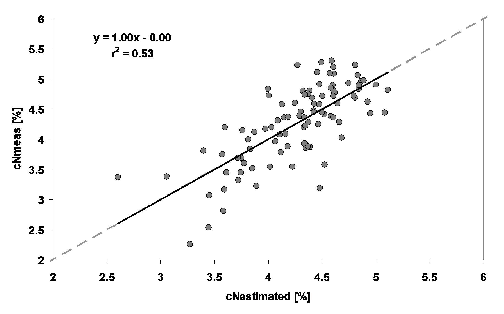
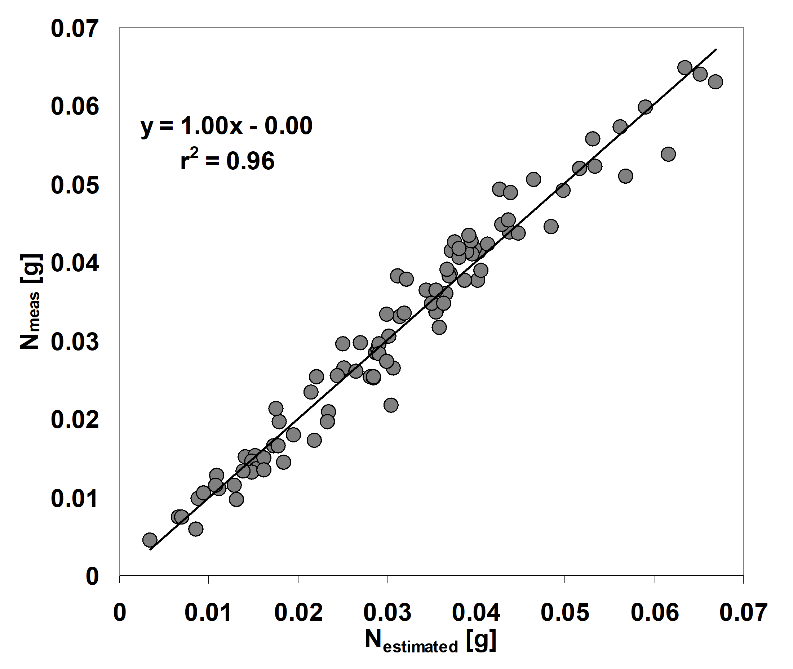
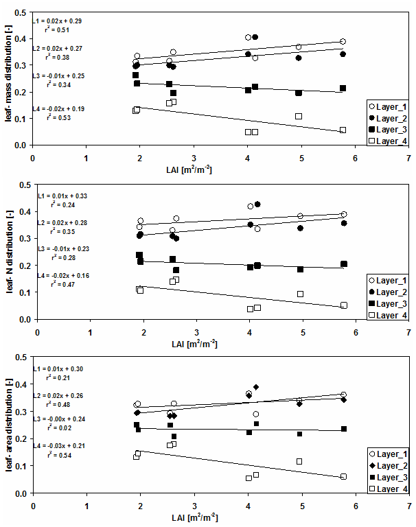
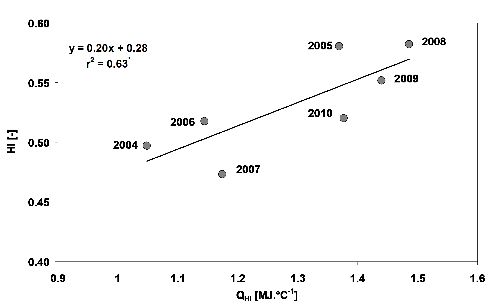
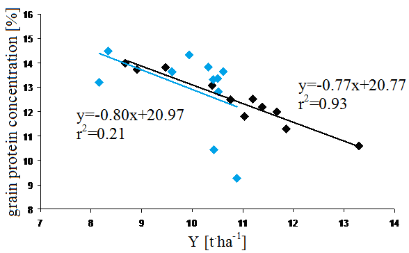
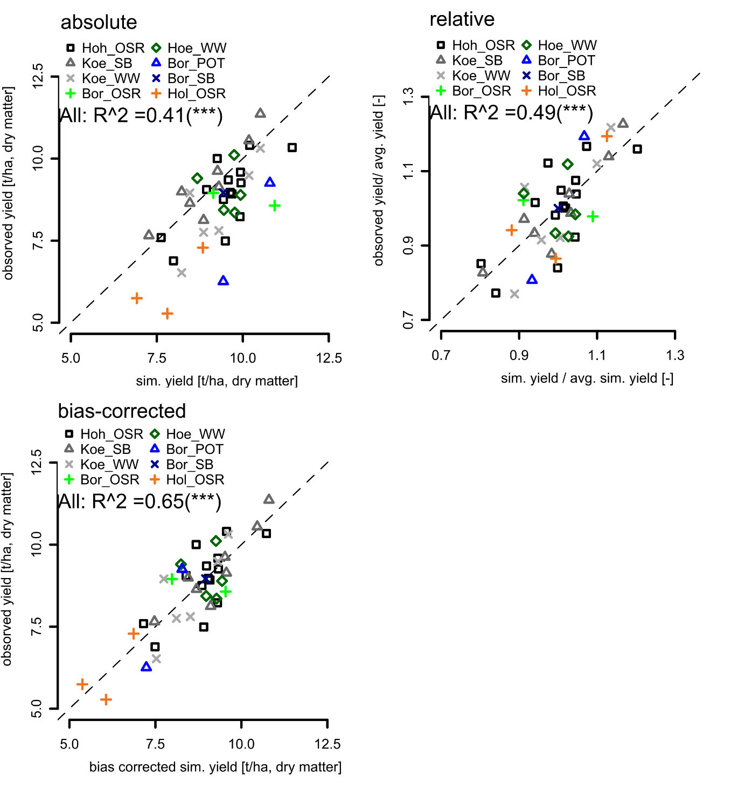

```{r}
#| label: SetupLibraries
#| include: FALSE

knitr::opts_chunk$set(echo = TRUE, warning = FALSE, message = FALSE, fig.align = "center", fig.width = 12, fig.height = 6, fig.pos = "h", fig.cap = TRUE)
rm(list = ls(all.names = TRUE))

library(rmarkdown)
library(bookdown)
library(soilwater)
library(tidyverse)
library(reticulate)
library(tinytex)
library(bibtex)
library(ggsci)
library(knitcitations)
library(kableExtra)
library(xml2)
library(ggpmisc)
source("ExtractInformationFromXML.R")
source("Rlib/DokuUtilFunctions.R")

options("citation_format" = "pandoc")

```

```{r}
#| include: false
fn_source <- "Q:/HUME/HUME/Components/Ceres Wheat/UHumeWheatPartitioning.pas"
fn_xml_docu <- "Q:/HUME/HUME/XML_Delphi_Docu/UHumeWheatPartitioning.xml"
doc <- read_xml(fn_xml_docu)
InstanceName <- "HumeWheatPartitioning1"

output <- ExtractXMLDocuInformation(fn_xml_docu, ClassName = "THumeWheatPartitioning")

```

# Summary

```{r}
#| echo: false
#| message: false
#| warning: false
#| results: asis
 
 GetFirstDevNotes(fn_xml_docu)
```

## Descendence

The class THumeWheatLeafArea has the following ancestor classes shown in @tbl-AncestorClasses.

```{r}
#| label: tbl-AncestorClasses
#| echo: false
#| tbl-cap: "Ancestor classes of THumeWheatPartitioning"

df <- GetAncestorClasses(fn_xml_docu,"THumeWheatPartitioning")

kable(df)

```

## Units and pool map

The object inventory in `csv_Hume_Docu/HumeWheatPartitioning.csv` contains 229 objects for `HumeWheatPartitioning1`: 23 states, 109 variables, 60 parameters, 30 external values, and 7 options. It includes inherited objects as well as objects declared in this class. The export identifies a configured Cubus/N160 run; its values are configuration values rather than necessarily Pascal defaults.

The tables below group the inventory by physical role and distinguish amounts, flows, concentrations, and derived outputs. Working units are inferred from the current calculation where the declared unit is inconsistent; these discrepancies are listed explicitly below. `DM` means dry matter, and `N` means nitrogen mass. Except for `C_Residues`, dry-matter pools are not elemental-carbon pools. The complete object lists remain at the end of this document.

### Spatial basis and update conventions

| Convention | Meaning and conversion |
|:--|:--|
| `_pl` | Per plant; multiply an amount or rate by `Plants` to obtain its ground-area equivalent. Some unsuffixed quantities, including `Assiflow` and `NSP_l`, also use this basis. |
| `_m2` | Per square metre of ground. Layer N and `sumNLAL` also use ground area despite inconsistent or absent suffixes. |
| `Plants` | Plant density, plants m$^{-2}$. |
| Area conversion | 1 g m$^{-2}$ = 10 kg ha$^{-1}$ = 0.1 dt ha$^{-1}$. |
| N concentration `Nc*` | Usually percent N in DM; divide by 100 before multiplying by dry mass. `Ncmob` is an exception: it is a mass fraction, g N g$^{-1}$ DM. |
| `SLN`, `optSLN` | N mass per square metre of leaf area, not per square metre of ground. |
| State `.v` and `.c` | `.v` stores the current value; `.c` is normally its change rate passed to integration. Entity type alone does not establish physical meaning: some registered states are recomputed totals or diagnostics. |
| Variable `.v` | Usually an algebraic result, but some variables retain memory or are updated directly, notably mobile N pools and photosynthetic layer N. They are not automatically integrated states. |
| Daily updates | Several routines directly add daily amounts or thermal increments without multiplying by timestep. The interpretation below follows the daily calculation used by the model; a different timestep requires a separate audit. |

### Dry-matter pools and related states

| Objects from the inventory | Type | Working units | Role and accounting rule |
|:--|:--|:--|:--|
| `LFWT_pl`, `STMWT_pl`, `GRNWT_pl` | State | g DM plant$^{-1}$ | Leaf, stem, and grain dry-matter pools. Grain allocation subtracts the same amount from the stem change rate. |
| `SEEDRV` | State | g DM plant$^{-1}$ | Seed reserves mobilized into assimilate flow during early growth. |
| `Senwt_pl` | State | g DM plant$^{-1}$ | Accumulated senescent dry matter receiving the non-remobilized leaf fraction and material transferred at maturity. The export incorrectly labels this state as N mass. |
| `RTWT_pl`, `DMfineroot` | State | g DM plant$^{-1}$; g DM m$^{-2}$ | Parallel per-plant and ground-area root representations. Their allocation rates are linked through plant density; do not add them as separate root pools. |
| `LFWT_m2`, `STMWT_m2`, `GRNWT_m2`, `SENWT_m2` | Variable | g DM m$^{-2}$ | Area equivalents of organ pools; not additional biomass. |
| `TOPWT_pl`, `TOPWT_m2` | Variable | g DM plant$^{-1}$; g DM m$^{-2}$ | Sum of leaf, stem, seed reserve, and grain DM; excludes senescent material. |
| `TSDM_m2` | Variable | g DM m$^{-2}$ | Code-defined total: leaf + stem + senescent + grain DM, plus `DMTrans_pl * Plants`; excludes seed reserves. The flow-like `DMTrans_pl` term makes this an accounting convention requiring care. |
| `DMtotal` | Inherited state | g DM m$^{-2}$ | Declared as total aboveground DM. No assignment synchronizing it with `TSDM_m2` was identified in this unit; do not assume they are interchangeable. |
| `C_Residues`, `N_Residues` | Inherited state | g C m$^{-2}$; g N m$^{-2}$ | Recomputed residue diagnostics, not additional independent organ pools. Residue carbon uses a factor of 0.45 on the selected dry-matter sum. |
| `CropHeight` | State | m | Geometric state, not a mass pool. |
| `TempSum` | State | degree days | Accumulated temperature since sowing used for root partitioning. The export now declares thermal time, although its degree symbol is garbled. |
| `NcLeafWinter`, `NcStemWinter` | State | % N in DM | Dynamic concentration states, not nitrogen amounts. |

### Nitrogen pools and representations

| Objects from the inventory | Type | Working units | Role and accounting rule |
|:--|:--|:--|:--|
| `NLeaf_pl`, `NStem_pl`, `NGrain_pl`, `NRoot_pl`, `NSen_pl` | State | g N plant$^{-1}$ | Organ and senescent N pools. The export now consistently identifies these amounts as g N per plant. |
| `NStoragepool_pl` | State | g N plant$^{-1}$ | Storage/mobile N pool. During grain filling its change rate reconciles it with `NSP_l + NSP_s`. |
| `NSP_l`, `NSP_s` | Variable | g N plant$^{-1}$ | Working leaf and stem mobile-N pools, updated directly. They represent storage-pool subdivisions; do not add them again to `NStoragepool_pl`. |
| `NShoot_pl` | State | g N plant$^{-1}$ | Recomputed sum of leaf, stem, storage, and grain N. Excludes root and senescent N; do not add it to its component pools. |
| `NLeaf_m2`, `NStem_m2`, `NGrain_m2`, `NRoot_m2`, `NSEN_m2`, `NStoragepool_m2`, `NShoot_m2` | Variable | g N m$^{-2}$ | Ground-area equivalents of the respective amounts. `NLeaf_m2` is green-leaf N, despite its exported comment referring to senescing leaves. |
| `NphLeaf1`–`NphLeaf4`, `NLeaf_Struc1`–`NLeaf_Struc4` | Variable | g N m$^{-2}$ ground | Photosynthetic and structural leaf-N representations by layer. These describe leaf N and are not additional organ pools. |
| `NLphot_pl`, `NLStruc_pl`, `NStemstruc_pl` | Variable | g N plant$^{-1}$ | Photosynthetic leaf, structural leaf, and structural stem N summaries/subfractions. |
| `sumNLAL` | Variable | g N m$^{-2}$ ground | Sum of structural and photosynthetic leaf-layer N. The declared per-plant unit is inconsistent with the summation. |
| `potGrainN_pl` | State | g N plant$^{-1}$ | Potential grain-N trajectory, not an additional actual N pool. The current export uses `potGrainN_pl` and explicitly identifies its N-mass basis. |
| `NUptake` | State | kg N ha$^{-1}$ | Integrated plant-N uptake accumulator; its change rate is an uptake flow. |

### Flows, constraints, and diagnostic quantities

| Objects from the inventory | Working units | Interpretation |
|:--|:--|:--|
| `Assiflow`, `GROLF`, `GROGRN`, `potGROGRN`, `SENL` | g DM plant$^{-1}$ d$^{-1}$ | Available assimilate flow, leaf growth, actual/potential grain growth, and leaf senescence. The exported `Assiflow` unit now agrees with its per-plant allocation basis. |
| `DMTrans_pl`, `NTrans_pl` | g DM or g N plant$^{-1}$ d$^{-1}$ in flow calculations | Remobilized material calculated from senescence. They are stored as variables with amount units and also enter daily accounting expressions; they are not cumulative remobilization pools. |
| `Translocation`, `Translocation_pl` | g DM m$^{-2}$; g DM plant$^{-1}$ | Empirical Rose translocation estimates used for the HI target, not extra transfers added directly to grain mass. |
| `BioPreAnthesis`, `BioPostAnthesis` | g DM m$^{-2}$ | Biomass reference at anthesis and net increase since that reference. |
| `SWMIN_pl`, `RSWT` | g DM plant$^{-1}$; g DM m$^{-2}$ | Minimum retained stem mass and available stem reserves; constraints/diagnostics, not additional biomass. The fixed floor `swmin_min` is a private scalar absent from the CSV. |
| `NDemand_pl`, `NDemand`, `PlantNDemand_rate_limited_m2` | g N plant$^{-1}$ d$^{-1}$; kg N ha$^{-1}$ d$^{-1}$; g N m$^{-2}$ d$^{-1}$ | Per-plant demand, area demand, and capped demand supplied to the soil interface. |
| `ActNUptake_m2`, `actPlantNupTake_m2`, `Ndef` | g N m$^{-2}$ d$^{-1}$ in the daily demand balance | Soil uptake, reported plant uptake, and uptake deficit. `Ndef` is declared as an amount but is formed from rates. |
| `Ndef_pl` | g N plant$^{-1}$ d$^{-1}$ in the daily deficit balance | Newly exported working deficit diagnostic, initialized from `Ndef / Plants` and reduced during redistribution. Its declared `[gN/plant]` omits the rate basis; it is not an N pool. |
| `piniGN` | g N per $10^6$ grains, numerically equivalent to mg N per $10^3$ grains | Initial grain-N scale used with `GPP * 10^-6`. The exported unit is a valid equivalent representation. |
| `GN_NRate` | g N per $10^6$ grains per degree day | Linear-phase potential grain-N coefficient; the declared per-plant amount unit is misleading. |
| `NcLeaf`, `NcStem`, `NcGrain`, `NcShoot`, `NcStraw`, `NcStruc`, `Nc_optLeaf`, `NoptStem`, `NcLAL__1`–`NcLAL__4` | % N in DM | Actual, structural, or optimum concentrations; not amounts. |
| `Ncmob`; `SLN`, `optSLN` | g N g$^{-1}$ DM; g N m$^{-2}$ leaf | Mobile-N mass fraction and specific leaf-N quantities. |
| `HI`, `HI_Ratjen`, `HI_Rose`, `potHI`, `NHI`, `NNI`, `NNI60`, `R`, `PTF`, `FFINEROOT`, `fStem`, `kf_d`, `kf_n`, organ mass ratios | Dimensionless | Indices, partitioning fractions, or adjustment factors; they must not be included in a mass balance as pools. |
| `GPSM`; `GPP`, `GPPVAR` | grains m$^{-2}$; grains plant$^{-1}$ | Grain counts. The exported `GPSM` unit `[k/m2]` must not be interpreted as thousands of grains per square metre. |
| `GRYD`; `TKM`; `KernelN` | dt ha$^{-1}$ at 14% moisture; g per 1000 grains; kg N ha$^{-1}$ | Yield and grain-quality outputs. |
| `SUMDTTGF`, `TSUMEffGF`; `DaysEffGF` | degree days; d | Thermal and calendar counters, not biomass states. |

### Interfaces and unit discrepancies requiring attention

Layer masses `MLAL1`–`MLAL4` (g DM m$^{-2}$ ground), layer areas `LAL_1`–`LAL_4` (m$^2$ leaf m$^{-2}$ ground), `LAI`, and `PARi1`–`PARi4` are external values supplied by the linked leaf-area model. Weather and development supply temperature and stage information. Many external-value unit fields are blank in the CSV, so the inventory alone is not a complete interface specification. In particular, the radiation basis of `PARi` must be checked against its producer before comparing it with the declared `k2` unit J m$^{-2}$ s$^{-1}$.

The updated export resolves the earlier unit warnings for `STMWT_pl`, `NRoot_pl`, `Assiflow`, the leaf/stem mass ratios, and `NcStraw`. `SLN` and `optSLN` now explicitly use leaf area. `TempSum` now has a thermal-time unit, with an encoding issue remaining. The following discrepancies are still present or newly visible:

| Inventory/declaration issue | Interpretation used in this map |
|:--|:--|
| `Senwt_pl`: `[gN/plant]` | This state stores senescent **dry matter**, so its working unit is g DM plant$^{-1}$. `NSen_pl` is the separate senescent N pool. |
| `NSP_l`, `NSP_s`: `[kgN/ha]` | Code arithmetic uses g N plant$^{-1}$ without an area conversion. |
| `sumNLAL`: `[gN/plant]`, comment says structural N | The calculation sums structural **and photosynthetic** layer N per square metre of ground. Both the spatial unit and description need correction. |
| `GN_NRate`: `[g/plant]` | Grain-number-normalized thermal-time coefficient, not a per-plant amount. |
| `Ndef`: `[gN/m2]`; `Ndef_pl`: `[gN/plant]` | Constructed from uptake/change rates; interpreted as daily deficit rates, not stored N masses. |
| `DMTrans_pl`: `[gDM/plant]`; `NTrans_pl`: `[g/plant]` | Flow-like quantities in daily allocation arithmetic; the labels omit time, and the latter does not explicitly identify N. |
| `GPSM`: `[k/m2]` | Arithmetic uses individual grains per square metre, not thousands of grains per square metre. |
| `Ncmob`: `[]` | Mobile N mass fraction, g N g$^{-1}$ DM; distinct from percentage concentrations. |
| `NcStem_ECLGE`: `[g/plant]` | Named as a concentration diagnostic but has an amount unit; no active assignment was identified in this unit. |
| `NLeaf_m2` comment refers to senescing leaves | This output is green-leaf N; `NSEN_m2` represents senescent N. |
| Missing external-value units and garbled degree/area symbols | Metadata/encoding issues remain; the map uses explicit physical descriptions rather than reproducing damaged symbols. |

These are documentation findings, not corrections to the CSV or Pascal declarations. Inherited `DMtotal` and legacy outputs such as `GROSTM` and `RGFILL` require confirmation of their active update paths before they should be used as independent accounting quantities. A complete conservation check must use the actual update sequence and include soil uptake, remobilization, senescence, and harvest exports; adding every listed state and variable would double-count several representations.

## Scientific Background

Notation tables at the beginning of each process section connect scientific symbols with Pascal identifiers. An expression or working scalar is identified explicitly when there is no one-to-one object mapping. Tables give the implementation basis; scientific equations on a ground-area basis require multiplication of per-plant amounts by `Plants`. These mappings do not imply that all historical equations are implemented without modifications.

The partitioning model module of HumeWheat is based mainly based on allometric approaches. The partitioning of dry matter between root, stem and leaf is calculated in two steps: first the root-shoot partitioning is calculated, followed by the leaf-stem partitioning. Both steps are modified under water limited conditions.

### Initialisation

| Scientific notation | Pascal identifier | Meaning and working basis |
|:--|:--|:--|
| $LA_{ini}$ | `iniLA` | Initial leaf area, cm$^2$ plant$^{-1}$. |
| $SLA_{pot}$ | `potSLA` | Potential specific leaf area; use the area basis compatible with `iniLA`. |
| $W_L$, $W_S$ | `LFWT_pl`, `STMWT_pl` | Leaf and stem DM, g plant$^{-1}$; the allometric relationship uses area-based mass internally. |
| $g$, $h$ | `g`, `h` | Allometric exponent and logarithmic intercept. |
| $N_{leaf}$, $N_{stem}$, $N_{root}$ | `NLeaf_pl`, `NStem_pl`, `NRoot_pl` | Organ N amounts, g N plant$^{-1}$. |
| $f_{RootN,ini}$ | `fRootN_ini` | Initial root-to-shoot N ratio. |


The initial leaf weight per plant after emergence is calculated from the initial leaf area and the specific leaf area (SLA) according to the following equation:

$$LFWT_{pl} = LA_{ini} / SLA_{pot}$$ {#eq-LFWTplini}

The stem weight per plant then is calculated from an allometric relationship between leaf and stem weight according to the following equation:

$$STMWT_{pl} = exp(g \cdot ln(LFWT_{pl} * plants) + h) / plants$$ {#eq-STMWTplini}

where *g* and *h* are parameters of the allometric relationship, i.e. the slope and the intercept of the linear regression between the logarithms of stem on leaf dry matter. The default values of *g* and *h* are set to 1.46 and -2.13 in the model.

The seed reserves are initialised from the parameter SEEDRV~ini~:

$$SEEDRV = SEEDRV_{ini}$$ {#eq-SEEDRVini}

The nitrogen amount in the leaf fraction is calculated from the leaf nitrogen concentration under optimum N supply and the initial leaf weight per plant according to the following equation:

$$NLeaf_{pl} = LFWT_{pl} * Nc_{opt_{Leaf}} / 100$$ {#eq-NLeafplini}

Accordingly, the nitrogen amount in the stem fraction is calculated from the stem nitrogen concentration under optimum N supply and the initial stem weight per plant according to the following equation:

$$NStem_{pl} = STMWT_{pl} * NoptStem / 100$$ {#eq-NStemplini}

The initial amount of N in the shoot of a single wheat plant is calculated as the sum of the N in the leaf and stem fraction:

$$NShoot_{pl} = NStoragepool_{pl} + NLeaf_{pl} + NStem_{pl} + NGrain_{pl}$$ {#eq-NShootplini}

The N amount in the root fraction is calculated from the initial shoot N amount and a fraction of the initial shoot N amount according to the following equation : $$NRoot_{pl} = NShoot_{pl} * fRootN_{ini}$$ {#eq-NRootplini}

### Change of the seed reserves (SeedRV)

| Scientific notation | Pascal identifier | Meaning and working basis |
|:--|:--|:--|
| $SEEDRV$ | `SEEDRV` | Seed-reserve DM, g plant$^{-1}$. |
| $SEEDRV_{ini}$ | `Ini_SEEDRV` | Initial seed-reserve DM, g plant$^{-1}$. |
| $k_{SEEDRV}$ | `k_SEEDRV` | Daily reserve-mobilization coefficient. |
| $Assiflow$ | `Assiflow` | Available assimilate flow, g DM plant$^{-1}$ d$^{-1}$; includes mobilized reserves. |


The seed reserves contribute to the daily dry matter accumulation rate of the canopy. Their rate of change is calculated as follows:

$$\frac{SEEDRV}{dt} = -k_{SEEDRV} \cdot SEEDRV$$ {#eq-SEEDRVdt}

where $k_{SEEDRV}$ is the rate of change of seed reserves. The value of $k_{SEEDRV}$ is set to 0.15 in the model, i.e. the daily change rate is 15% of the actual amount.

The rate of change of seed reserves is added to the assimilate flow called 'Assiflow' in the model:

$$Assiflow = Assiflow - \frac{SEEDRV}{dt}$$ {#eq-Assiflow}

### Root-Shoot partitioning

| Scientific notation | Pascal identifier | Meaning and working basis |
|:--|:--|:--|
| $f_{R0}$, $f_{Rdec}$ | `fFineRoot0`, `FFineRootDec` | Initial fine-root allocation fraction and its decrease per degree day. |
| $TS$ | `TempSum` | Accumulated thermal time since sowing in the current implementation, degree days. |
| $ptf$ | `PTF` | Shoot fraction after drought and N adjustments. |
| $R_T$ | `TransIntRatio` | Transpiration supply ratio. |
| $dW_{root}/dt$ | `RTWT_pl.c`, `DMFineRoot.c` | Parallel root-DM rates per plant and per square metre; do not add them together. |
| $NNI$ | `NNI` | Actual-to-critical shoot N concentration ratio. |


According to [@kage2000simulation] the fraction of dry matter allocated to the shoot is calculated assuming linear decrease of the root fraction with temperature sum (TS, base temperature of 0°C) since emergence. If the transpiration is not water limited, the potential plant top fraction ptf~p~ (dimensionless) is calculated as follows:

$$\begin{align}
pt f_p(t) &=
\begin{cases}
1-\max\left(0, f_{R0}-f_{Rdec}\cdot TS(t)\right) & \text{if ISTAGE < 5} \\
1 & \text{if ISTAGE > 5}
\end{cases}
\end{align}$$ {#eq-ShootRootAllometric}

where ISTAGE\<5 is the period before grain filling [@ritchie1985description], f~R0~ is the initial fraction of dry matter allocated to the root fraction and f~Rdec~ is the decrease of this fraction per unit of accumulated temperature. Drought stress not only decreases plant total dry mass, but also changes proportion among root stem, and leaf. Under drought, root:shoot ratio is usually increased, whereas leaf shoot ratio is usually decreased ([@liu2004]). According to CERES-WHEAT, the potential plant top fraction is reduced under water limited conditions:

$$\text{ptf(t)}=pt{{f}_{p}}\text{ - 0}\text{.1}\cdot \text{(1-}{{\text{R}}_{\text{T}}}\text{(t))}$$ {#eq-ptf}

The increase of shoot dry matter is therefore:

$$\frac{d{{W}_{shoot}}}{dt}=\frac{d{{W}_{tot}}}{dt}\cdot ptf(t)$$ {#eq-dWsh_dt}

while the increase in root dry matter is calculated as:

$$\frac{d{{W}_{root}}}{dt}=\frac{d{{W}_{tot}}}{dt}-\frac{d{{W}_{shoot}}}{dt}$$ {#eq-dWr_dt}

### Leaf-Stem partitioning

| Scientific notation | Pascal identifier | Meaning and working basis |
|:--|:--|:--|
| $W_L$, $W_S$ | `LFWT_m2`, `STMWT_m2` | Leaf and stem DM on the ground-area basis used for allometry, g m$^{-2}$. |
| $g$, $h$ | `g`, `h` | Exponent and logarithmic intercept of stem mass versus leaf mass. |
| $f_{stem}$ | `fStem` | Stem fraction of shoot-DM growth. |
| $k_{f,d}$, $k_{f,n}$ | `kf_d`, `kf_n` | Drought and N adjustment factors; the larger factor is used. |
| $pF_{root}$, $pF_{crit}$ | `PSIroot`, `psi_crit` | Root-zone pF and the drought threshold. |
| $kf_{inc}$ | `psi_s` | Slope of the drought adjustment. |
| $NNI_{crit}$, $NNI_{inc}$ | `NNIcrit`, `NNIinc` | N adjustment threshold and slope. |
| $dW_L/dt$, $dW_S/dt$ | `LFWT_pl.c`, `STMWT_pl.c` | Allocation rates per plant, g DM plant$^{-1}$ d$^{-1}$. |


The development driven concept for leaf-stem partitioning of shoot dry matter used in CERES-WHEAT was replaced by an allometric approach according to [@stuetzel1988], [@stuetzel1991], [@Kage1999b]. 

Vegetative plant mass $W_V$ consists of leaf mass $W_L$ and stem mass $W_S$, neglecting root mass:

$$
W_V = W_L + W_S
$$ {#eq-vegetative-mass}

The corresponding growth rates are also additive:

$$
\frac{dW_V}{dt} = \frac{dW_L}{dt} + \frac{dW_S}{dt}
$$ {#eq-vegetative-growth}

Assuming allometric growth, the logarithms of stem and leaf mass are linearly related:

$$
\ln W_S = h + g \ln W_L
$$ {#eq-allometric-log}

Rearranging gives:

$$
W_S = e^h W_L^g
$$ {#eq-allometric-mass}

Differentiating @eq-allometric-mass with respect to $W_L$ yields:

$$
\frac{dW_S}{dW_L} = e^h g W_L^{g-1}
$$ {#eq-allometric-derivative}

Applying the chain rule gives:

$$
\frac{dW_S}{dt} =
\frac{dW_S}{dW_L}\frac{dW_L}{dt}
$$ {#eq-allometric-chain-rule}

Substituting @eq-allometric-derivative into @eq-allometric-chain-rule and then substituting the resulting expression into @eq-vegetative-growth yields:

$$
\frac{dW_L}{dt} =
\frac{dW_V}{dt}\frac{1}{1 + e^h g W_L^{g-1}}
$$ {#eq-LeafStemmAllometric}

The data base for the parameterization of leaf-stem partitioning originates from several field experiments on the experimental farm Hohenschulen and includes destructive measurements of several cultivars (Meyer-Schatz et al., unpublished. The fraction of stem growth f~stem~ (dimensionless) on shoot growth is thereby expressed as a function of leaf dry matter W~leaf~ [g.m-2], with two allometric fit parameters (g, h).

#### Modified Leaf-Stem partitioning due to water limited conditions

For considering the drought induced decrease in leaf mass accumulation a correction factor kf (dimensionless) was added to the allometric equation [@ratjen2016a]:

$${{\text{f}}_{\text{stem}}}\text{(t)=min(1,1-}\frac{1}{\text{(1}+{{\text{e}}^{\text{h}}}\cdot \text{g}\cdot {{\text{W}}_{\text{L}}}{{\text{(t)}}^{\text{g-1}}}\text{)}}\cdot kf\text{(t))}$$ {#eq-LeafStemmAllometricDrought}

The minimum value of k~f~ is one, but increases linearly if pF~root~ exceeds the threshold value pF~crit~. Thereby, kf~inc~ describes the slope of the increase, proportional to the difference between pF~root~ and pF~crit~:

$$\text{kf(t)=max(1,1}+\text{(p}{{\text{F}}_{\text{root}}}\text{(t)-p}{{\text{F}}_{\text{crit}}}\text{)}\cdot \text{k}{{\text{f}}_{\text{inc}}})$$ {#eq-kfAllometricDrought}

A rain out shelter experiment was used for the parameterization of the concept using measured water contents and destructive shoot, leaf and stem dry mass. The measured dry matter accumulation between two sample dates was linear interpolated against thermal time. The daily pF~root~ values, linearly interpolated between measurements, were related from measured water contents and simulated vertical root distribution. Starting with measured stem dry matter for each plot the allometric parameters (g,h) were optimized by minimizing the RMSE between estimated and measured stem dry mass without consideration of the kf correction. As a second step the pF~crit~ and kf~inc~ were calibrated considering pFroot by minimizing the RMSE between estimated and measured stem dry mass. The daily increase of stem dry matter W~stem~ [g.m-2] is calculated as a function of f~stem~ and increase in shoot dry matter:

$$\frac{\text{d}{{\text{W}}_{\text{stem}}}}{\text{dt}}\text{=}\frac{\text{d}{{\text{W}}_{\text{shoot}}}}{\text{dt}}\cdot {{f}_{stem}}(t)$$ {#eq-dWstemdt}

where the increase of leaf dry matter W~leaf~ [g^.^m-2] is the difference between shoot and stem dry matter accumulation:

$$\frac{\text{d}{{\text{W}}_{leaf}}}{\text{dt}}\text{=}\frac{\text{d}{{\text{W}}_{\text{shoot}}}}{\text{dt}}\text{-}\frac{\text{d}{{\text{W}}_{\text{stem}}}}{\text{dt}}$$ {#eq-dWleaf_dt}

The partitioning of dry matter between leaf and stem is influenced by the soil water potential. Under water stress conditions the partitioning of dry matter to the stem is increased (@fig-AlloDrought).

![Relationship between the log-transformed leaf \[ln(DML)\] and stem mass \[ln(DMS)\] for W0 and W100 treatments (g=slope). W100 (black): r2 =0.96, n = 26; W0 (white): r2 =0.87, n = 23.](jac12165-fig-0002-m.jpg){#fig-AlloDrought}

#### Modified Leaf-Stem partitioning due to nitrogen limitation

The nitrogen limitation effects on leaf stem partitioning are implemented as follows.

$$kf_n = max\left(1, 1 + (NNI_{crit} - NNI) \cdot NNI_{inc} \right)$$ {#eq-kf_n}

then the stem fraction with effects from drought stress and nitrogen limitation becomes:

$$f_{Stem} = min\left(1, f_{Stem} \cdot max\left(kf_d, kf_n\right)\right)$$ {#eq-f_stem2}

```{r}
#| label: fig-fStem
#| fig-cap: Stem fraction of shoot dry matter increase as a function of leaf dry matter and NNI (left) and as a function of leaf dry matter and psi_root (right)
#| fig-align: center
#| echo: false
#| 

fStem <- function(LFWT, h, g){
  fStem <- 1 - 1/(1 + exp(h) * LFWT^(g-1) * g)
  return(fStem)
}


kf_n <- function(NNI, NNI_crit, NNI_inc){
  kf_n <- pmax(1, 1 + (NNI_crit - NNI) * NNI_inc)
  return(kf_n)
}


kf_d <- function(psi_root, psi_crit, psi_s){
  kf_d <- pmax(1, 1 + (abs(psi_root) - psi_crit) * psi_s)
  return(kf_d)
}

h <- -2.13
g <- 1.46
psi_crit <- 2.24
psi_s <- 0.296

NNI_crit <- 1.377
NNI_inc <- 0.595


df_fStem <- expand.grid(LFWT = seq(50, 200, 1),
                        NNI = seq(0.5, 1.5, 0.25))
library(RColorBrewer)
myScale_color <- c('#ffffcc','#d9f0a3','#addd8e','#78c679','#31a354','#006837')#brewer.pal(length(unique(df_fStem$NNI)), "GnYl")


df_fStem$fStem_ <- fStem(df_fStem$LFWT, h, g)
df_fStem$kf_n <- kf_n(df_fStem$NNI, NNI_crit, NNI_inc)
df_fStem$fStem <- pmin(1,df_fStem$fStem_ * df_fStem$kf_n)  

df_fStem$NNI <- as.factor(df_fStem$NNI)

p1 <- ggplot(data = df_fStem, aes(x = LFWT, y = fStem, color=NNI)) +
  geom_line( size=2) +
  labs(x = "Leaf dry matter [g m^-2]", y = "fStem [0..1]") +
  theme_bw(base_size = 20) +
  scale_color_manual(values = myScale_color)  +
  theme(legend.position = "top")
#p1


df_fStem2 <- expand.grid(LFWT = seq(50, 200, 1),
                        psi_root = seq(1, 5, 1))

df_fStem2$kf_d <- kf_d(df_fStem2$psi_root, psi_crit, psi_s)
df_fStem2$fStem_ <- fStem(df_fStem2$LFWT, h, g)
df_fStem2$fStem <- pmin(1, df_fStem2$fStem_ * df_fStem2$kf_d)

df_fStem2$psi_root <- as.factor(df_fStem2$psi_root)
myScale_color2 <- c('#f7fbff','#deebf7','#c6dbef','#9ecae1','#6baed6','#4292c6','#2171b5','#084594')#brewer.pal(length(unique(df_fStem$NNI)), "GnYl")

p2 <- ggplot(data = df_fStem2, aes(x = LFWT, y = fStem, color=psi_root)) +
  geom_line( size=2) +
  labs(x = "Leaf dry matter [g m^-2]", y = "fStem [0..1]") +
  theme_bw(base_size = 20) +
  scale_color_manual(values = myScale_color2) +
  theme(legend.position = "top") +
  theme(axis.title.y = element_blank()) +
  theme(axis.text.y = element_blank()) 
#p2


library(patchwork)
p <- p1 + p2
p

```

For more details see [@Ratjen2016].

## Leaf nitrogen concentration

| Scientific notation | Pascal identifier | Meaning and working basis |
|:--|:--|:--|
| $Nc_{opt,leaf}$ | `Nc_optLeaf` | Optimum leaf N concentration, % of DM. |
| $Nc_{leaf,Vf1}$, $Nc_{leaf,Vf2}$ | `NcLeafVf1`, `NcLeafVf2` | Slope and intercept of the leaf-N dilution relationship. |
| $LFWT$ | `LFWT_m2` | Leaf DM used by the dilution curve, g m$^{-2}$ ground. |
| $Nc_{leaf,winter}$ | `NcLeafWinter` | Dynamic winter leaf N concentration, % of DM. |
| $Nc_{leaf,min}$, $rgr_{NcLeafWinter}$ | `NcLeafMin`, `rgr_NcLeafWinter` | Winter concentration parameter and recovery coefficient. |
| $EC_{crit,NcLeaf}$ | `ECcritNcLeaf` | Stage threshold selecting the dilution curve. |
| $Nc_{leaf}$ | `NcLeaf` | Actual concentration derived from leaf N and DM; distinct from the optimum. |


After the BBCH stage of the crop reaches the value $EC_{crit_{NcLeaf}}$, which is set to 27, i.e. before shooting, the leaf nitrogen concentration \[% N of DM\] is calculated as follows:

$$Nc_{opt_{leaf}} = Nc_{leaf_{Vf1}} \cdot LFWT + Nc_{leaf_{Vf2}}$$ {#eq-NcOptLeaf} 

thereby $Nc_{leaf_{Vf1}}$ and $Nc_{leaf_{Vf2}}$ are parameters of the linear relationship between leaf nitrogen concentration and leaf dry matter. The default values of $Nc_{leaf_{Vf1}}$ and $Nc_{leaf_{Vf2}}$ are set to -0.0061 and 5.9543 in the model.

In a transitional phase between autumn and spring, the leaf nitrogen concentration is calculated as follows:

$$\begin{align*}
\frac{ Nc_{Leaf_{Winter}}}{dt} & = (Nc_{leaf_{winter}} - Nc_{leaf_{min}}) \cdot rgr_{NcLeafWinter} \cdot \\
  &  GlobRad \cdot \frac{ 1 - (Nc_{leaf_{winter}}- Nc_{leaf_{min}})}  {Nc_{Leaf_{Vf1}} \cdot LFWT + Nc_{Leaf_{Vf2}} - Nc_{leaf_{min}}}
\end{align*}$$ {#eq-NcLeafWinter}

where $Nc_{leaf_{min}}$ is the minimum leaf nitrogen concentration, $rgr_{NcLeafWinter}$ is the relative growth rate of the leaf nitrogen concentration, and $GlobRad$ is the global radiation. The default values of $Nc_{leaf_{min}}$ and $rgr_{NcLeafWinter}$ are set to 1.5 and 0.0001 in the model. The value of $Nc_{leaf_{min}}$ is the minimum leaf nitrogen concentration. The value of $rgr_{NcLeafWinter}$ is the relative growth rate of the leaf nitrogen concentration. The value of $GlobRad$ is the global radiation. The value of $Nc_{leaf_{min}}$ is the minimum leaf nitrogen concentration. The value of $rgr_{NcLeafWinter}$ is the relative growth rate of the leaf nitrogen concentration. The value of $GlobRad$ is the global radiation.

if DayOfYear \< 150 then if TEMPM \> 0 then // transitional phase between autumn and spring

$$Nc_optLeaf = Nc_{LeafWinter}$$ {#eq-NcOptLeafWinter}

else

### Calc_Leaf_N_Change

Above the critical BBCH stage ($EC_{crit_{NcLeaf}}$, set to EC 27, i.e. end of tillering) the optimum leaf nitrogen concentration is calculated from a linear dilution curve:

$$Nc_{opt_{Leaf}} = Nc_{Leaf_{Vf1}} \cdot LFWT_{m2} + Nc_{Leaf_{Vf2}}$$

where $Nc_{Leaf_{Vf1}}$ and $Nc_{Leaf_{Vf2}}$ are parameters of the linear relationship between leaf nitrogen concentration and leaf dry matter. The default values of $Nc_{Leaf_{Vf1}}$ and $Nc_{Leaf_{Vf2}}$ are set to -0.0061 and 5.9543 in the model.

```{r}
#| label: fig-NcLeaf
#| fig-cap: Leaf nitrogen concentration under optimal N supply as a function of leaf dry matter
#| fig-align: center
#| echo: false

NcLeaf <- function(LFWT, NcLeaf_a, NcLeaf_b){
  NcLeaf <- NcLeaf_a * LFWT + NcLeaf_b
  return(NcLeaf)
}

NcLeaf_a <- -0.0061
NcLeaf_b <- 5.9543

LFWT <- seq(0, 400, 1)

df_NcLeaf <- data.frame(LFWT = LFWT)
df_NcLeaf$NcLeaf <- NcLeaf(df_NcLeaf$LFWT, NcLeaf_a, NcLeaf_b)

ggplot(data = df_NcLeaf) +
  geom_line(aes(x = LFWT, y = NcLeaf, color=NcLeaf), size=2) +
  labs(x = "Leaf dry matter [g m^-2]", y = "NcLeaf [%]") +
  theme_bw(base_size = 20) +
  scale_color_gradient(low = "yellow", high = "darkgreen") +
  scale_y_continuous(limits = c(0, 6)) 


```

The daily change of the leaf nitrogen amount per plant is calculated from the daily change of leaf dry matter and the leaf nitrogen concentration under optimal N supply and the difference between the actual leaf nitrogen amount and the optimal leaf nitrogen amount in the leaf fraction of a plant:

$$\frac {N_{Leaf_{pl}}}{dt} = \frac {LFWT_{pl}}{dt} \cdot Nc_{opt_{Leaf}} / 100 + Nc_{opt_{Leaf}} / 100 \cdot LFWT_{pl} - N_{Leaf_{pl}}$$ {#eq-NLeafpl}

### Stem N

| Scientific notation | Pascal identifier | Meaning and working basis |
|:--|:--|:--|
| $Nc_{opt,stem}$ | `NoptStem` | Optimum stem N concentration, % of DM. |
| $a$, $b$ in the stem dilution curve | `NcStem_a`, `NcStem_b` | Parameters of $1/(a+b\,STMWT_{m2})$. |
| $W_{stem}$ | `STMWT_m2` | Stem DM used by the dilution curve, g m$^{-2}$ ground. |
| $Nc_{stem,winter}$ | `NcStemWinter` | Dynamic winter stem N concentration, % of DM. |
| $N_{stem}$ | `NStem_pl` | Actual stem N amount, g N plant$^{-1}$. |


A similar approach is used to calculate the stem nitrogen concentration under optimal N supply. The stem nitrogen concentration under optimal N supply is, however, calculated from a non-linear dilution curve:

$$NearOptNCStem = 0.98 \cdot (1 / (NcStem_a + NcStem_b \cdot STMWT_{m2}))$$

```{r}
#| label: fig-NcStem
#| fig-cap: Stem nitrogen concentration as a function of stem dry matter

NcStem <- function(STMWT, NcStem_a, NcStem_b){
  NcStem <- 0.98 * (1 / (NcStem_a + NcStem_b * STMWT))
  return(NcStem)
}

STMWT <- seq(0, 400, 1)
NcStem_a <- 0.1475
NcStem_b <- 0.0011


df_NcStem <- data.frame(STMWT = STMWT)
df_NcStem$NcStem <- NcStem(df_NcStem$STMWT, NcStem_a, NcStem_b)
df_NcStem$NcStemNearOpt <- 0.98*df_NcStem$NcStem

ggplot(data = df_NcStem) +
  geom_line(aes(x = STMWT, y = NcStem, color=NcStem),size=2) +
  geom_line(aes(x = STMWT, y = NcStemNearOpt), size=1, linetype=2) +
  labs(x = "Stem dry matter [g m^-2]", y = "NcStem [%]") +
  theme_bw(base_size = 20) +
  scale_color_gradient(low = "yellow", high = "darkgreen") +
  scale_y_continuous(limits = c(0, 5)) 


```

## Grain filling

### Grain number

| Scientific notation | Pascal identifier | Meaning and working basis |
|:--|:--|:--|
| $GPSM$ | `GPSM` | Grains m$^{-2}$, not thousands of grains m$^{-2}$. |
| $G_4$, $a$ | `GM4`, `GM4_2` | Grain-number regression coefficient and exponent. |
| $DM_{65}$ | `TOPWT_m2` at grain-number establishment | Shoot DM near EC 65, g m$^{-2}$; not a separately stored parameter. |
| $NNI_{60}$ | `NNI60` | N nutrition index captured from EC 60; capped at one in the grain-number regression. |
| $Q45$ | `Q45` | Photothermal quotient for the preceding 45 daily values. |
| $GPP$, $GPPVAR$ | `GPP`, `GPPVAR` | Established and early estimated grain numbers per plant. |


The model for grain number follows the assumption that the grain number per square meter (GPSM) is a function of the shoot dry matter at mid flowering i.e. EC65 (DM~65~), the nitrogen nutrition index at EC 60 (NNI~60~), and the average photothermal quotient from 45 d preceding anthesis (Q~45~):

$$GPSM= G4\cdot ln \left( DM_{65} \cdot min \left( NNI_{60}\right) \cdot Q_{45} \right)^{a}$$ {#eq-GPSM}

where G4 and a are parameters of the regression equation. The default values of G4 and a are set to 149.153 and 2.6233 in the model (see @fig-GPSM). Within the source code the parameter G4 ist called GM4 and the parameter a is named GM4_2. See [@ratjen2012] for the derivation of this approach.

![Relationship between the log transformed product of different plant parameters (NNI60 = N nutrition status of wheat crops at anthesis, Q45= the photo thermal quotient 45 d preceding anthesis, DM65 = total shoot dry matter per square meter at anthesis) and grain number per square meter (GPSM) of wheat crops from field experiments with different N fertilizations from [@ratjen2012].](GPSM_regression.png){#fig-GPSM}

For the estimation of grains per plant in order to calculate the initial value of grain N an early estimate of GPSM is derived from the shoot dry matter at anthesis (TOPWT~m2~) and the photothermal quotient 45 d preceding anthesis (Q~45~):

if (EC \>= 40) and (NNI60 \<= 0) and if $ln(TOPWT_{m2} \cdot Q45) > 0$ then

$$GPPVAR = \left ( G4 \cdot \left ( ln \left ( TOPWT_{m2} \cdot Q45 \right) \right)^{a} \right) / plants$$ {#eq-GPPVAR}

where G4 and a are parameters of the regression equation. Within the source code the parameter G4 ist called GM4 and the parameter a is named GM4_2.

### Initialisation

| Scientific notation | Pascal identifier | Meaning and working basis |
|:--|:--|:--|
| $GRNWT_{ini}$ | `iniGRNWT` | Initial dry mass per grain, mg grain$^{-1}$. |
| $GPPVAR$ | `GPPVAR` | Early estimate of grains per plant. |
| $GRNWT_{pl}$ | `GRNWT_pl` | Actual grain DM, g plant$^{-1}$. |
| $dGRNWT_{pl}/dt$ | `GRNWT_pl.c` | Grain-DM change rate; subtracted from `STMWT_pl.c`. |


The initial change of the grain weight is calculated using a sliding N and C accumulation of initial grain N & C from EC 40 to 65 from the parameter $GRNWT_{ini}$ and the missing fraction of that weight. Initial grain weight per plant and the grain filling rate according to the following equation:

$$\frac{GRNWT_{pl}}{dt} = GRNWT_{ini} / 1000 \cdot GPPVAR \cdot min\left( 1, \frac{(EC - 40)}{ (65 - 40)}\right) - GRNWT_{pl}$$ {#eq-GRNWTplini}

where $GRNWT_{ini}$ is the initial weight per grain in mg, $GPPVAR$ is the estimated number of grains per plant, $EC$ is the EC stage. The value of $GRNWT_{ini}$ is set to 3.5 in the model.\
Because the initial weight comes from the stem fraction, the rate of change of DM stem has to be adjusted:

$$\frac{STMWT_{pl}}{dt} = \frac{STMWT_{pl}}{dt} - \frac{GRNWT_{pl}}{dt}$$ {#eq-STMWTpl_corr}

### Translocation and grain filling

| Scientific notation | Pascal identifier | Meaning and working basis |
|:--|:--|:--|
| $HI_{pot}$ | `potHI` | Selected dynamic target; Ratjen or bounded Rose estimate. |
| $HI_{int}$, $HI_{inc}$ | `QHI_INT`, `QHI_INC` | Ratjen regression intercept and slope. |
| $avQ_{HI}$, $Q_{HI}$ | `QHI` | Cumulative radiation-to-temperature quotient over the implemented EC window. |
| $B_{pre}$, $B_{post}$ | `BioPreAnthesis`, `BioPostAnthesis` | Anthesis biomass reference and subsequent net increase, g DM m$^{-2}$. |
| $T$, $T_{pl}$ | `Translocation`, `Translocation_pl` | Empirical Rose estimates per ground area and per plant; not direct extra transfers. |
| $p_{intercept}$, $p_{post}$, $p_{pre}$, $p_{pre2}$ | `pintercept`, `pBioPostAnth`, `pBioPreAnth`, `pBioPreAnth2` | Rose intercept, post-anthesis, linear pre-anthesis, and quadratic pre-anthesis coefficients. |
| $HI$ | `HI` | Actual grain-to-total-shoot DM ratio; not assigned directly from `potHI`. |


A common approach is to assume grain growth as a function of biomass accumulation after anthesis plus reserves (e.g. [@jamieson1998] or simply as the sum of accumulated biomass after a defined growth stage (e.g. Ritchie 1985). An alternative approach is to simulate potential grain yield as a linear increase in harvest index (HI) with accumulated thermal time from the beginning of grain-filling to maturity (e.g. [@sinclair1992; @chapman1993; @hammer1995; @goyne1996; @meinke1998a] assuming a constant or cultivar specific potential HI. Thereby, the harvest index is the ratio of grain to shoot dry mass at harvest.

The module separates the empirical potential harvest-index target from reserve availability and grain allocation. `OptHIcalcversion` selects the radiation-dependent Ratjen approach [@ratjen2016a] or the biomass-dependent Rose approach [@rose2026]. Both estimates are calculated in `CalcPotHI` from EC 60 onward; before EC 60, both estimates, the selected `potHI`, and the Rose translocation outputs are zero.

The independent option `optRSWT` selects a fixed structural stem minimum (`CWT3`) or a minimum updated using the selected HI target (`pothi`). A normalized logistic developmental multiplier scales grain demand, and available stem reserves constrain actual grain growth. Carbon transferred to grains is subtracted from the stem pool. Actual HI and reported grain yield are derived from simulated grain mass, rather than assigning actual HI directly to the potential target.

#### Potential harvest index

##### Option Ratjen

According to the simplifying ‘SWMIN’ concept of Ceres-Wheat the straw fraction of the shoot at harvest can be seen as proportional to the stem mass at begin of spike growth (W~0~), where grain mass is proportional to the shoot accumulation after ear emergence (\$\Delta W\$):

$$
HI=\frac{{{W}_{grain}}}{{{W}_{straw}}+{{W}_{grain}}}\sim\frac{\Delta W_{grain}}{{{W}_{0}}+\Delta W_{grain}}
$$ {#eq-HI1}

The shoot mass accumulation is the product of the average amount of intercepted light (Q) times the light use efficiency (avLUE) over the period of spike growth($\Delta t$)

$$\Delta W=\sum Q \times LUE \times \Delta t$$ {#eq-DeltaW}

whereby the integration is done over the duration of the spike growth phase in thermal time (dtt) divided by the average temperature during this period (avT)

The shoot mass accumulation can also be described as the product of the average amount of intercepted light (avL) times the average light use efficiency (avLUE) over the period of spike growth (Δt)

$$\Delta W = \Delta t_{GF} \cdot \overline{Q} \cdot \overline{LUE}$$ {#eq-DeltaW1}

whereby Δt~GF~ is the duration of the spike growth phase in thermal time (dtt) divided by the average temperature during this period (avT):

$$\Delta t_{GF}=\frac{dtt} {\overline{T}}$$ {#eq-DeltaT}

Insertion of @eq-HI1 into @eq-DeltaT yields:

$$\Delta W=\frac{dtt\cdot \overline{Q} \cdot \overline{LUE}}{\overline{T}}=\overline{Q_T}\cdot \overline{LUE}\cdot dtt$$ {#eq-DeltaW2}

whereby Q~T~ is photo-thermal-quotient \[MJ^.^°C^-1^\], defined as the ratio of mean global radiation and mean temperature over the period of $\Delta t$.

Assuming dtt and avLUE as constant, variation in HI is a function of W~0~ and avQ only. In unstressed crops the variation in W~0~ is small compared to the variation of $\Delta W$, which is more influenced by water limitation. Thus, the potential HI (HI~pot~) is dominated by avQ. Following this reasoning, the potential HI in HumeWheat if the Option 'OptHIcalcversion=ratjen' is calculated as a function of photo-thermal-quotient avQHI \[MJ.°C-1\] defined as the running ratio of mean global radiation and mean temperature over the period between booting and mid of milk ripe stage (BBCH 50-75):

$$HI_{pot}(t)=H{{I}_{\operatorname{int}}}+H{{I}_{inc}}\times av{{Q}_{HI}}(t)$$ {#eq-HIpot}

where $HI_{int}$ and $HI_{inc}$ are parameters of the regression equation. The default values of $HI_{int}$ and $HI_{inc}$ are set to 0.2786 and 0.196 in the model.

{fig-align="center"}

In `CalcRates`, `CalcQHI` accumulates global radiation and mean temperature while `50 < EC < 75`. `QHI` is their cumulative ratio. The Ratjen target is evaluated from EC 60 onward and remains based on the accumulated quotient after EC 75. Unlike the Rose target, the Ratjen target is not explicitly bounded to the interval from zero to one.

##### Option Rose

With `OptHIcalcversion = 'rose'`, the empirical harvest index `HI_Rose` is updated dynamically and supplies the potential harvest-index target during grain filling. Let $B_{pre}$ denote `BioPreAnthesis` and $B_{post}$ denote `BioPostAnthesis`, both in $\mathrm{g\,m^{-2}}$. The model updates $B_{pre}$ from `TSDM_m2` up to and including EC 65; after EC 65, it calculates the net biomass increase as

$$
B_{post} = TSDM_{m2} - B_{pre}.
$$ {#eq-rose-post-anthesis}

The empirical estimate of translocated dry matter $T$ (`Translocation`, $\mathrm{g\,m^{-2}}$) is estimated by

$$
T = p_{intercept} + p_{post} B_{post} + p_{pre} B_{pre} + p_{pre2} B_{pre}^{2}.
$$ {#eq-rose-translocation}

The default parameter values in `CreateAllPars` in `UHumeWheatPartitioning.pas` are:

| Symbol          | Code parameter | Default value |
|:----------------|:---------------|--------------:|
| $p_{intercept}$ | `pintercept`   |        33.989 |
| $p_{post}$      | `pBioPostAnth` |      -0.48536 |
| $p_{pre}$       | `pBioPreAnth`  |       0.50254 |
| $p_{pre2}$      | `pBioPreAnth2` |  -0.000046665 |

The code declares all four parameters with the unit `[-]`. Dimensionally, the intercept has units of $\mathrm{g\,m^{-2}}$, the two linear coefficients are dimensionless, and the quadratic coefficient has units of $\mathrm{m^{2}\,g^{-1}}$ when biomass is supplied in $\mathrm{g\,m^{-2}}$.

Translocation per plant and the dimensionless harvest index are calculated as

$$
T_{pl} = \frac{T}{Plants}, \qquad
HI_{Rose} = \frac{B_{post} + T}{B_{pre} + B_{post}}.
$$ {#eq-rose-hi}

With the default parameter values, this gives

$$
HI_{Rose} =
\frac{33.989 + 0.51464 B_{post} + 0.50254 B_{pre}
- 0.000046665 B_{pre}^{2}}{B_{pre} + B_{post}}.
$$ {#eq-rose-hi-defaults}

The raw empirical estimate remains available as `HI_Rose`. For allocation, the selected target is bounded to the interval from zero to one:

$$
HI_{pot} = \max(0, \min(1, HI_{Rose})).
$$ {#eq-rose-target}

The common logistic grain-filling calculation uses this target in place of the Ratjen target:

$$
GROGRN_{pot} = (TOPWT_{pl} + Senwt_{pl})\,HI_{pot}\,RHI - GRNWT_{pl}.
$$ {#eq-rose-grain-demand}

The independent option `optRSWT` controls reserve availability. Both settings first capture stem weight at or after EC 37. `CWT3` retains that minimum; `pothi` updates it from EC 60 using the selected dynamic target and the existing lower bound `swmin_min`:

$$
SWMIN_{pl} = \max\left(swmin_{min},
\frac{STMWT_{m2}-(TSDM_{m2}\,HI_{pot}-GRNWT_{m2})}{Plants}\right).
$$ {#eq-rose-stem-minimum}

Actual grain growth remains limited by available stem reserves. Carbon allocated to grains is subtracted from the stem pool. The logistic development equations are shared by Ratjen and Rose; a nonpositive target stops logistic grain growth, and an initial relative HI at or above one uses `RHI = 1` to avoid an invalid logarithm.

Reported grain yield follows the simulated grain dry-mass state for both approaches:

$$
GRYD = \frac{GRNWT_{pl}\,Plants}{10\cdot0.86}.
$$ {#eq-rose-yield}

Here, `Plants` is plant density in $\mathrm{plants\,m^{-2}}$. Division by 10 converts $\mathrm{g\,m^{-2}}$ to $\mathrm{dt\,ha^{-1}}$, and division by 0.86 expresses yield at 14% residual moisture. There is no separate Rose yield override after EC 90. The Rose regression supplies a time-varying target rather than directly imposing the final grain mass; reserve limits and development can therefore keep actual HI below the target. The raw translocation estimate is not clamped. It is used to construct the Rose target; it is not an additional carbon transfer applied directly to the grain pool. Actual transfer is determined by `GROGRN`.

@fig-hi-rose shows the default relationship for six equally spaced post-anthesis biomass values between 400 and 1000 $\mathrm{g\,m^{-2}}$.

```{r}
#| label: fig-hi-rose
#| echo: false
#| fig-cap: Harvest index according to Rose versus pre-anthesis biomass, for six post-anthesis biomass levels using the default model parameters.
#| fig-height: 6
#| fig-width: 10

local({
  pintercept <- 33.989
  pBioPostAnth <- -0.48536
  pBioPreAnth <- 0.50254
  pBioPreAnth2 <- -0.000046665

  rose_data <- expand.grid(
    BioPreAnthesis = seq(400, 1000, length.out = 301),
    BioPostAnthesis = seq(400, 1000, length.out = 6)
  )
  rose_data$Translocation <- with(rose_data,
    pintercept + pBioPostAnth * BioPostAnthesis +
      pBioPreAnth * BioPreAnthesis + pBioPreAnth2 * BioPreAnthesis^2
  )
  rose_data$HI_Rose <- with(rose_data,
    (BioPostAnthesis + Translocation) / (BioPreAnthesis + BioPostAnthesis)
  )

  rose_plot <- ggplot2::ggplot(rose_data, ggplot2::aes(
    x = BioPreAnthesis, y = HI_Rose, colour = factor(BioPostAnthesis)
  )) +
    ggplot2::geom_line(linewidth = 1) +
    ggplot2::scale_colour_viridis_d(
      name = expression(BioPostAnthesis ~ "[g" ~ m^{-2} ~ "]")
    ) +
    ggplot2::scale_x_continuous(limits = c(400, 1000)) +
    ggplot2::labs(
      x = expression(BioPreAnthesis ~ "[g" ~ m^{-2} ~ "]"),
      y = expression(HI[Rose] ~ "[-]")
    ) +
    ggplot2::theme_minimal(base_size = 12)

  print(rose_plot)
})
```

#### Reserve availability

| Scientific notation | Pascal identifier | Meaning and working basis |
|:--|:--|:--|
| $S_{structural}$, $swmin_{min}$ | `swmin_min` | Private fixed stem-DM floor captured from EC 37, g plant$^{-1}$. |
| $SWMIN_{pl}$ | `SWMIN_pl` | Current retained stem minimum, g DM plant$^{-1}$. |
| $RSWT$ | `RSWT` | Available stem reserves, g DM m$^{-2}$ ground. |
| $Plants$ | `Plants` | Plant density used to convert between per-plant and ground-area quantities. |


Both `optRSWT` settings capture the first positive stem mass at or after EC 37 as the fixed structural floor `swmin_min`, and initialize `SWMIN_pl` to that value. Both values are reset in `Init`. `CWT3` retains the captured minimum. From EC 60, `pothi` updates `SWMIN_pl` using the selected Ratjen or Rose target, as in @eq-rose-stem-minimum. The fixed floor and the dynamic minimum are distinct: the latter may rise and fall but cannot fall below the structural floor. The available reserves are

$$
RSWT = \max(0, STMWT_{m2} - SWMIN_{pl}\,Plants).
$$ {#eq-stem-reserves}

#### Dynamics of grain filling

| Scientific notation | Pascal identifier | Meaning and working basis |
|:--|:--|:--|
| $t$, $SUMDTT_{GF}$ | `SUMDTTGF` | Accumulated thermal time of logistic grain filling, degree days. |
| $X_m$ | `Xm` (local), from `P5` | Thermal duration used to normalize the endpoint. |
| $X_{mid}$ | `Xmid` (local), from `dECDP` | Underlying logistic shape parameter, degree days. |
| $R_0$ | `FInitialRHI`; local `RHI_ini` | Initial relative grain fraction captured once from actual grain mass. |
| $L(t)$, $L(X_m)$ | `LogisticNow`, `LogisticEnd` (locals) | Underlying logistic values before normalization. |
| $RHI$ | `RHI` (local) | Normalized developmental multiplier; not a registered output or necessarily `HI/potHI`. |
| $B_{target,pl}$ | `TargetBiomass_pl` (local) | `TOPWT_pl + Senwt_pl`, g DM plant$^{-1}$. |
| $GROGRN_{pot}$, $GROGRN$ | `potGROGRN`, `GROGRN` | Potential and reserve-limited daily grain-DM increments per plant. |


`CalcGRFILL` is called while `40 <= EC < 90`. It first establishes initial grain mass while grain number is not yet available, then uses logistic development once `GPSM > 0`. These conditions, rather than a separate EC-75 cutoff, determine the transition.

##### Initial grain growth before grain number is established

For `EC > 40` and `GPSM <= 0`, the target initial grain mass is based on `GPPVAR`, an early estimate of grains per plant:

$$
\frac{dGRNWT_{pl}}{dt} = \frac{iniGRNWT}{1000}\,GPPVAR\,
\min\left(1,\frac{EC-40}{65-40}\right)-GRNWT_{pl}.
$$ {#eq-GRNWTpl}

`iniGRNWT` defaults to 3.5 mg per grain, not grams per plant. The factor 1/1000 converts milligrams to grams. The calculated grain-mass change is subtracted from the stem change rate:

$$
\left(\frac{dSTMWT_{pl}}{dt}\right)_{new}
=\left(\frac{dSTMWT_{pl}}{dt}\right)_{previous}
-\frac{dGRNWT_{pl}}{dt}.
$$ {#eq-STMWTpl}

##### Normalized logistic development after grain number is established

Once `GPSM > 0`, `CalcGRFILL` increments `SUMDTTGF` by `max(0, TEMPM)` on each call. This thermal-time accumulation is independent of positive grain nitrogen. For the daily timestep, it represents cumulative degree days since the start of logistic grain filling. The duration is derived from `P5`:

$$
X_m=\frac{P5+21.5}{0.05}.
$$ {#eq-Xm}

The shape parameter remains

$$X_{mid}=dECDP,$$ {#eq-Xmid}

where `dECDP` defaults to 250 degree days and also controls the exponential-to-linear transition of potential grain-N accumulation. It has not been removed from the model.

Define the grain-demand biomass basis per plant as

$$B_{target,pl}=TOPWT_{pl}+Senwt_{pl}.$$ {#eq-grain-target-biomass}

At the first valid logistic calculation, the initial relative grain fraction is captured from actual grain mass:

$$
R_0=\max\left(10^{-12},\min\left(1,
\frac{GRNWT_{pl}(t_0)}{B_{target,pl}(t_0)\,HI_{pot}(t_0)}\right)\right).
$$ {#eq-RHIINI}

The code stores this value in `FInitialRHI` and retains it until `Init` resets its flag. It is not recalculated from daily biomass or from `GPP * iniGRNWT`. This preserves the initial grain pool across the transition from the early grain-number estimate to the final grain number. The positive floor avoids a singular logarithm for an empty initial pool. The selected `potHI` continues to update dynamically.

For $0<R_0<1$, the underlying logistic curve is

$$
b=\frac{1-R_0}{R_0},\qquad
r=\frac{\ln(1/R_0-1)}{X_{mid}},\qquad
L(t)=\frac{1}{1+b\exp(-rt)}.
$$ {#eq-rRHI}

Here $t=SUMDTTGF$ and $L(0)=R_0$. For intermediate thermal times, the developmental multiplier is normalized as

$$
RHI(t)=R_0+(1-R_0)\frac{L(t)-R_0}{L(X_m)-R_0},
\qquad 0<t<X_m.
$$ {#eq-RHI}

The endpoint rules are $RHI(0)=R_0$ and $RHI(t)=1$ for $t\ge X_m$. If $R_0\ge1$, the multiplier is one immediately. When $|L(X_m)-R_0|<10^{-10}$, the code uses the linear limiting form $R_0+(1-R_0)t/X_m$. Intermediate results are bounded to $[R_0,1]$, and exponential arguments are bounded to $[-700,700]$ for numerical stability. Nonpositive target HI, biomass, duration, `dECDP`, grain number per plant, or `iniGRNWT` prevents logistic allocation.

`RHI` is a developmental multiplier, not necessarily the measured ratio `HI/potHI`: reserve constraints and different biomass definitions can separate those quantities. @fig-RHI illustrates the implemented normalized curve with a fixed initial condition.

```{r}
#| label: CalcRHI
#| echo: false

P5 <- 11.67
Xm <- (P5 + 21.5) / 0.05
dECDP <- 250
# Illustrative values at the first valid logistic calculation [g/plant].
initial_grain_pl <- 0.15
initial_target_biomass_pl <- 2
initial_potHI <- 0.55
R0 <- max(1e-12, min(1,
  initial_grain_pl / (initial_target_biomass_pl * initial_potHI)))

normalized_rhi <- function(thermal_time, R0, Xm, Xmid) {
  stopifnot(R0 > 0, R0 <= 1, Xm > 0, Xmid > 0)
  if (R0 >= 1) return(rep(1, length(thermal_time)))
  b <- (1 - R0) / R0
  r <- log(1 / R0 - 1) / Xmid
  logistic <- function(t) 1 / (1 + b * exp(pmax(-700, pmin(700, -r * t))))
  span <- logistic(Xm) - R0
  if (abs(span) < 1e-10) {
    result <- R0 + (1 - R0) * thermal_time / Xm
  } else {
    result <- R0 + (1 - R0) * (logistic(thermal_time) - R0) / span
  }
  result <- pmax(R0, pmin(1, result))
  result[thermal_time <= 0] <- R0
  result[thermal_time >= Xm] <- 1
  result
}

SUMDTTGF <- sort(unique(c(seq(0, 1.1 * Xm, length.out = 301), Xm)))
RHI <- normalized_rhi(SUMDTTGF, R0, Xm, dECDP)
stopifnot(abs(normalized_rhi(0, R0, Xm, dECDP) - R0) < 1e-12,
          normalized_rhi(Xm, R0, Xm, dECDP) == 1)
```

```{r}
#| label: fig-RHI
#| echo: false
#| fig-cap: "Normalized grain-filling multiplier: the initial fraction is retained and the multiplier reaches one at Xm."
#| fig-align: center

plot(SUMDTTGF, RHI, type = "l", lwd = 2,
     xlab = "Thermal time since start of logistic grain filling [degree days]",
     ylab = "Developmental multiplier RHI [-]")
abline(v = Xm, lty = 2, col = "grey50")
points(c(0, Xm), c(R0, 1), pch = 19)
legend("bottomright", legend = "Xm", lty = 2, col = "grey50", bty = "n")
```

##### Grain allocation and reported outputs

The potential grain-mass increment uses the current target biomass and selected HI:

$$
GROGRN_{pot}=B_{target,pl}\,HI_{pot}\,RHI-GRNWT_{pl}.
$$ {#eq-GROGRNpot}

Actual grain growth is nonnegative and constrained by the current stem reserve:

$$
GROGRN=\max\left(0,\min\left(GROGRN_{pot},STMWT_{pl}-SWMIN_{pl}\right)\right).
$$ {#eq-grain-allocation}

`GRNWT_pl.c` is assigned `GROGRN`, and the same amount is subtracted from `STMWT_pl.c`. A declining target stops allocation when the calculated demand is negative; it does not withdraw grain mass. Outside `40 <= EC < 90`, the grain growth rate is set to zero. After EC 90, remaining stem and leaf material is transferred to senescent pools when stem mass is positive.

Actual HI is calculated as $HI=GRNWT_{m2}/TSDM_{m2}$, and grain yield follows @eq-rose-yield. The current implementation uses different biomass definitions: grain demand uses $(TOPWT_{pl}+Senwt_{pl})Plants$, whereas actual HI and the Rose biomass reference use `TSDM_m2`, which includes `DMTrans_pl * Plants` and excludes the seed-reserve term contained in `TOPWT_pl`. Consequently, even at `RHI = 1`, exact equality of actual and potential HI is not guaranteed. Reserve limitations and the independent EC-90 cutoff can also prevent reaching the target if thermal time has not reached `Xm`.

## Calculation sequence and timestep resets

All growth, allocation, senescence, grain filling, and N-demand calls in `CalcRates` are now inside a single `ISTAGE >= 1` emergence gate. Inactive rates and demand diagnostics are cleared before that gate. Redundant internal emergence checks have been removed from leaf/stem allocation and senescence. Seed-reserve mobilization is also called only after emergence; its remaining conditions are `ISTAGE < 2` and positive seed reserves. Other developmental, biomass, and validity checks remain local to their procedures.

The global model calls `CalcVars` for all submodels, then `CalcRates`, measured-value updates, and finally submodel integration. In this class, `CalcVars` refreshes organ and shoot totals before calculating shoot N concentration and actual HI. Actual leaf N concentration is taken from the current leaf N and dry-mass pools, rather than overwritten from the previous rate calculation's layer totals. Diagnostics with an empty denominator are reset explicitly.

`CalcRates` clears conditional temperature and winter-concentration rates, the storage-N rate, and potential grain growth before rebuilding rates. It calculates the current senescence-derived `DMTrans_pl` before adding it to assimilate flow, then calculates seed-reserve mobilization, roots, leaf/stem allocation, leaf and stem N, senescence, potential HI, grain number, grain growth, and N redistribution. Soil demand is recalculated after the final drought and maturity rate changes, so the request corresponds to the final organ rates. `Integrate` resets uptake/deficit diagnostics and applies any soil-uptake correction before inherited state integration.

`Init` resets the fixed stem floor, stored logistic initial fraction and its flag, photothermal accumulators and their 45-day buffers, and private N-transfer intermediates, including `Ndsen`. Inherited initialization handles registered states and variables. The drought-impact enum is assigned on every initialization rather than retaining its previous value for an unrecognized option.

These ordering corrections do not introduce a new deficit-allocation scheme or change the global timestep/output convention. In particular, some algebraic output totals still represent the pre-integration state when the framework saves state outputs after integration; resolving that global convention requires a separate design decision.

## Soil-N interface

| Scientific notation | Pascal identifier | Meaning and working basis |
|:--|:--|:--|
| $P$ | `Plants` | Plant density, plants m$^{-2}$. |
| $D_{pl}$ | `NDemand_pl` | Uncapped net demand, g N plant$^{-1}$ d$^{-1}$. |
| $D_{m2}$ | `NDemand_pl * Plants` | Uncapped area demand; `NDemand` reports ten times this value in kg N ha$^{-1}$ d$^{-1}$. |
| $D_{soil}$ | `PlantNDemand_rate_limited_m2` | Capped soil request, g N m$^{-2}$ d$^{-1}$. |
| $U_{soil}$ | `ActNUptake_m2` | Soil-model uptake converted to g N m$^{-2}$ d$^{-1}$. |
| $Ndef$, $\Delta_{pl}$ | `Ndef`, initial `Ndef_pl` | Area-based deficit and its initial per-plant equivalent; `Ndef_pl` changes during correction. |
| $U_{plant}$ | `actPlantNupTake_m2` | Reported plant uptake; its definition depends on the integration branch. |
| $Nbal$ | `Nbal` | Per-plant correction residual, not a complete whole-model N balance. |


The soil-N interface separates potential plant demand, the capped demand exposed to the soil model, and the uptake used to correct plant nitrogen allocation. `CalcPlantNDemand`, called at the end of `CalcRates`, calculates demand after the final organ growth, remobilization, senescence, and maturity-transfer rates have been assembled. `Integrate` then reads soil uptake and, when nitrogen limitation is enabled, adjusts the plant N change rates before calling inherited integration. The following description follows the current implementation and its daily-rate convention.

### Potential demand and the uptake cap

Let $P=Plants$ and let $\dot N_j$ denote the change rate of an N pool in g N plant$^{-1}$ d$^{-1}$. Potential net demand is

$$
D_{pl}=\max\left(0,
\dot N_{Stem}+\dot N_{Leaf}+\dot N_{Grain}+\dot N_{Sen}
+\dot N_{Storage}+\dot N_{Root}\right).
$$ {#eq-soil-n-potential-demand}

This is `NDemand_pl`. It is a net demand: internal redistribution can offset organ requirements, so it is not the sum of positive organ demands alone. The ground-area demand is $D_{m2}=P\,D_{pl}$ in g N^.^m^-2.^d^-1^. The output `NDemand` expresses that uncapped demand in kg N ha$^{-1}$ d$^{-1}$ as $10P\,D_{pl}$.

The demand exposed through `PlantNDemand_rate_limited_m2`, the published property `Var_NUptakeRate`, and `GetNUptakeRate` is

$$
D_{soil}=\min\left(\frac{maxNupTake}{10},\,P\,D_{pl}\right).
$$ {#eq-soil-n-capped-demand}

`D_soil` has units g N m$^{-2}$ d$^{-1}$. The default `maxNupTake` is 6, interpreted here as kg N ha$^{-1}$ d$^{-1}$ even though its declared unit omits the time denominator. Thus, the default cap is 0.6 g N m$^{-2}$ d$^{-1}$. Division by 10 converts the hectare-based rate to the ground-area rate. The cap limits the request supplied to the soil interface; it does not itself rescale the organ N change rates in `CalcNRates`.

### Soil uptake and the decision in Integrate

When `SoilNitrogenMod` is assigned and is a `TSoilNitrogenUp`, `Integrate` obtains the soil-model uptake as

$$
U_{soil}=\frac{SoilNitrogenMod.ActNUptake}{10}.
$$ {#eq-soil-n-actual-uptake}

The result is stored in `ActNUptake_m2`, in g N m$^{-2}$ d$^{-1}$. Deficit redistribution is applied only if all three conditions hold:

1. $U_{soil}<P\,D_{pl}$;
2. the effective nitrogen-impact option is `NImpact`;
3. `EC < 90`.

The comparison uses the **uncapped** plant demand, not `D_soil`. Consequently, the cap itself can cause a deficit when full uncapped demand exceeds the uptake permitted by the soil request. The deficit is

$$
Ndef=P\,D_{pl}-U_{soil},\qquad
\Delta_{pl}=\frac{Ndef}{P}.
$$ {#eq-soil-n-deficit}

The first quantity is the area-based deficit rate. `setNimpact` initially stores the second quantity in `Ndef_pl`, then reduces that diagnostic as parts of the deficit are allocated. Its value after correction is therefore not necessarily the original whole-plant deficit. Positive plant density is required for these conversions.

### Redistribution of an unmet N demand

`setNimpact` saves the original root, leaf, stem, grain, and storage N change rates and then modifies them in this order:

1. **Storage pool:** subtract the per-plant deficit from `NStoragepool_pl.c`, with a lower rate bound of `-NStoragepool_pl.v` for the daily update. Deduct the achieved reduction from the remaining deficit.
2. **Roots:** allocate part of the remaining deficit according to the root-to-vegetative-shoot dry-mass ratio $RTWT_{pl}/(STMWT_{pl}+LFWT_{pl})$. The root N change rate is bounded below by the negative amount above structural root N. Structural root N is calculated as $RTWT_{pl}\,NcStruc/100$.
3. **Stem/grain and leaf shares:** split the remaining shoot deficit using `pNdefAllo`, default 0.63. The nominal stem/grain share is 63%, and the initial leaf share is 37%; these are shares of the remaining deficit, not fixed fractions of total N uptake.
4. **Grains:** if the grain N change rate is positive, reduce it by part of the stem/grain share, weighted by $NGrain_{pl}/(NStem_{pl}+NGrain_{pl})$. Grain N accumulation is constrained between zero and its original rate. The achieved reduction is deducted from the stem/grain share.
5. **Stem:** reduce `NStem_pl.c`, retaining the structural N amount $STMWT_{pl}\,NcStruc/100$. Any unallocated part of this share is added to the leaf deficit.
6. **Leaves:** subtract the resulting leaf deficit from `NLeaf_pl.c`. After grain number is established, photosynthetic N in all four leaf layers is also multiplied by the ratio of corrected to uncorrected next-step leaf N, when that ratio is below one.

The code does not impose an equivalent explicit nonnegative leaf-N bound in the final step. Therefore, this sequence must not be interpreted as a guarantee that all corrected N pools remain nonnegative under severe deficits. The root and stem bounds and the photosynthetic-leaf scaling also assume the daily update convention; they are not general timestep-independent safeguards.

### Corrected uptake and balance diagnostics

After deficit redistribution, the plant uptake diagnostic is reconstructed from the corrected N change rates:

$$
U_{plant}=P\,\max\left(0,
\dot N_{Stem}^{corr}+\dot N_{Leaf}^{corr}+\dot N_{Grain}^{corr}
+\dot N_{Sen}+\dot N_{Storage}^{corr}+\dot N_{Root}^{corr}\right).
$$ {#eq-soil-n-corrected-uptake}

This value is stored in `actPlantNupTake_m2`. `NUptake.c = 10 U_plant` converts it to kg N ha$^{-1}$ d$^{-1}$ for the cumulative `NUptake` state. It is derived from the corrected plant balance rather than assigned directly from `ActNUptake_m2`. Agreement with soil uptake is expected only to the extent that the correction removes the complete deficit consistently.

`Nbal` records the change in the summed stem, leaf, grain, storage, and root N rates plus the original per-plant deficit:

$$
Nbal=\sum_{j\in\{Stem,Leaf,Grain,Storage,Root\}}
\left(\dot N_j^{corr}-\dot N_j^{original}\right)+\Delta_{pl}.
$$ {#eq-soil-n-balance-residual}

A value near zero indicates that the rate reductions account for the requested deficit; it is not by itself a complete whole-model N conservation test.

### Other branches and interpretation limits

If the linked soil model is present but the deficit-correction condition is false, `Integrate` sets `actPlantNupTake_m2 = D_soil`, assigns `NUptake.c = 10 D_soil`, and sets `Nbal = 0`. This includes runs with `NoNImpact` and stages at or beyond EC 90. In this branch the reported plant uptake follows capped demand, rather than necessarily equalling the soil-model uptake. The cap alone does not reconcile all organ change rates with that reported uptake.

At entry to `Integrate`, uptake rates, `Ndef`, `Ndef_pl`, and `Nbal` are reset to zero. If no compatible soil-N model is linked, no alternative uptake is inferred: reported uptake remains zero, although the existing plant N allocation rates are still integrated. Thus, an unlinked run is not a verified soil-plant N balance. Deficit diagnostics describe the current correction only and no longer retain a previous timestep's deficit.

## N dynamics during the grain-filling period

Modelled plant N uptake during vegetative growth is driven by carbon accumulation, accounting for the decrease in N concentration with increasing leaf and stem dry mass. This concept is less appropriate during the reproductive phase, when N dynamics are dominated by sink–source relationships (e.g. [@Bertheloot2008], and N translocation increasingly controls light-use efficiency (LUE) and leaf senescence.

In many crop models, such as CERES-WHEAT, the influence of sink N demand on photosynthesis is not modelled explicitly. Instead, effective LUE is reduced as a function of thermal time and/or the ratio of current to structural stem mass (see the CERES-WHEAT `CarboRed` function; @ritchie1986cereswheat). Empirical descriptions of leaf senescence and grain N translocation based solely on thermal time and carbon translocation require several fitted parameters that are difficult to determine and have limited physiological interpretation.

As an alternative, reproductive-canopy N dynamics are simulated as a function of the grain sink and the light environment, following [@Bertheloot2008]. This mechanistic approach describes N fluxes within a representative tiller containing four leaf layers. Its parameters are constrained by experimental data.

The approach provides estimates of potential root N uptake after anthesis and N mass per unit leaf area (specific leaf N, SLN). SLN is functionally related to canopy photosynthesis and leaf senescence and has previously been used to model LUE and senescence during grain filling (e.g. @Meinke1998).

The challenge is to connect this plant N model with the process-based representation of carbon assimilation and allocation used during vegetative growth. The following sections summarize the N model and the interfaces required for its implementation.

### Initial lamina distribution at anthesis

| Scientific notation | Pascal identifier | Meaning and working basis |
|:--|:--|:--|
| $W_{l[i]}$, $L_{[i]}$ | `MLAL[i]`, `LAL[i]` | External layer DM and leaf area index; supplied by the leaf-area model. |
| $N_{l[i]}$ | `NphLeaf[i] + NLeaf_struc[i]` | Layer N, g N m$^{-2}$ ground; a sum rather than a separate object. |
| $rN_{l,int[i]}$, $rN_{l,inc[i]}$ | `relLayerN_int[i]`, `relLayerN_S[i]` | Related fitted N-distribution coefficients; current code applies them to nonstructural N, not directly to total N. |
| $LAI$ | `LAI` | Leaf area index; current N-distribution calculation bounds the working value to 2–6. |


Implementing the N model first requires a description of the relative distribution of leaf tissue among canopy layers. This distribution is treated as uniform during vegetative growth.

Rain-out-shelter experiments were used to describe lamina distribution at anthesis. Because leaf distribution follows the canopy light gradient, it depends on LAI. The fractions of leaf dry mass, N mass, and leaf area in each layer were therefore related to LAI.

Both water-limited and well-irrigated treatments were included to obtain sufficient variation in LAI at anthesis. Leaf N concentration was estimated from chlorophyll index measurements (Minolta SPAD-502) and leaf size. The estimation function had previously been calibrated using Experiment 4 with the same cultivar.

For the first three layers, leaf dry mass $W_{l[i]}$ [$\mathrm{g\,m^{-2}}$] is calculated as

$$
W_{l[i]} =
W_{leaf}
\left(
rW_{l,int[i]} + rW_{l,inc[i]}\,LAI
\right),
\qquad i=1,2,3.
$$ {#eq-n-leaf-mass-distribution}

Here, $rW_{l,int[i]}$ and $rW_{l,inc[i]}$ are dimensionless fitted distribution parameters.

Leaf area $L_{[i]}$ [$\mathrm{m^2\,m^{-2}}$] and leaf N mass are calculated analogously:

$$
L_{[i]} =
LAI
\left(
rL_{int[i]} + rL_{inc[i]}\,LAI
\right).
$$ {#eq-n-leaf-area-distribution}

$$
N_{l[i]} =
N_{leaf}
\left(
rN_{l,int[i]} + rN_{l,inc[i]}\,LAI
\right).
$$ {#eq-n-leaf-n-distribution}

The dry mass and leaf area of the fourth layer are calculated as the respective canopy totals minus the sums for the first three layers.

### Decomposition of total stem and lamina N

| Scientific notation | Pascal identifier | Meaning and working basis |
|:--|:--|:--|
| $N_{l[i]}^{ph}$ | `NphLeaf[i]` | Photosynthetic leaf-layer N, g N m$^{-2}$ ground. |
| $N_{l[i]}^{struc}$ | `NLeaf_struc[i]` | Structural leaf-layer N, g N m$^{-2}$ ground. |
| $N_l^{mob}$, $N_s^{mob}$ | `NSP_l`, `NSP_S` | Mobile N working pools, g N plant$^{-1}$; convert before comparing with layer amounts. |
| $N_{tot}^{mob}$ | `NStoragepool_pl`; working sum `NSP_l + NSP_S` | Stored and working representations of mobile N; do not add them together. |
| $N_s^{ph}$ | `NStem_pl - NStemstruc_pl` | Corresponding nonstructural stem N, g N plant$^{-1}$; no separate photosynthetic-stem state. |
| $cN_{struc}$ | `NcStruc / 100` | Mass fraction for multiplication by DM; `NcStruc` itself is expressed as percent in these calculations. |


Total N in each leaf layer and in the stem is divided into structural and photosynthetic fractions:

- Structural N: $N_{l[i]}^{struc}$ and $N_s^{struc}$.
- Photosynthetic N: $N_{l[i]}^{ph}$ and $N_s^{ph}$.

Following @Bertheloot2008, the common mobile N pool $N_{tot}^{mob}$ is divided into leaf and stem fractions, $N_l^{mob}$ and $N_s^{mob}$.

Structural N is the product of dry mass and structural N concentration $cN_{struc}$. At the beginning of grain filling, photosynthetic N is initialized as total N minus structural N:

$$
N_{l[i]}^{ph} =
N_{l[i]} - W_{l[i]}\,cN_{struc}.
$$ {#eq-n-initial-photosynthetic-leaf}

$$
N_s^{ph} =
N_{stem} - W_{stem}\,cN_{struc}.
$$ {#eq-n-initial-photosynthetic-stem}

The initial stem fraction of the mobile N pool is proportional to stem N:

$$
N_s^{mob} =
N_{tot}^{mob}
\frac{N_{stem}}{N_{stem}+N_{leaf}}.
$$ {#eq-n-initial-mobile-stem}

The remaining mobile N is assigned to the leaf fraction:

$$
N_l^{mob} = N_{tot}^{mob} - N_s^{mob}.
$$ {#eq-n-initial-mobile-leaf}

### Grain N accumulation

| Scientific notation | Pascal identifier | Meaning and working basis |
|:--|:--|:--|
| $pGN$ | `pINIGN` (exported as `piniGN`) | Initial grain-N scale, g N per million grains, equivalent to mg N per thousand grains. |
| $iniGN$ | Initial grain-N amount derived using `pINIGN` and grain number | Scientific area-based quantity; code initializes `NGrain_pl` per plant. |
| $N_g^{pot}$ | `potGrainN_pl` | Potential grain-N state, g N plant$^{-1}$; multiply by `Plants` for an area basis. |
| $N_{grain}$ | `NGrain_pl` | Actual grain N, g N plant$^{-1}$. |
| $\gamma$ | `rgr_GrainN` | Exponential-phase potential grain-N accumulation coefficient. |
| $	au$ | `dECDP` | End of endosperm cell division, degree days. |
| $tsum$ | `SUMDTTGF` | Thermal time shared with carbon grain filling; independent of positive grain N. |


Unlike @Bertheloot2008, who assumed an initial grain N content independent of grain number, initial grain N $iniGN$ [$\mathrm{g\,m^{-2}}$] is calculated from initial N per $10^6$ grains, $pGN$ [g], and grain number per square metre, $GPSM$:

$$
iniGN = pGN\,10^{-6}\,GPSM.
$$ {#eq-n-initial-grain}

Grain number is calculated as

$$
GPSM =
G_4
\left[
\ln\left(DM_{65}\,NNI_{60}\,Q45\right)
\right]^a.
$$ {#eq-n-grain-number}

See @Ratjen2012 for details of the grain-number calculation. Initial grain N concentration, obtained from $iniGN$ and initial grain mass $iniGM$, approximately corresponds to leaf N concentration at anthesis, about 4.3%.

Following @Bertheloot2008, potential grain N accumulation during BBCH 65–90 is divided into two phases.

The first phase represents endosperm cell division and follows an exponential function of accumulated thermal time. It ends when thermal time since the beginning of grain filling, $tsum$ [$^\circ\mathrm{Cd}$], reaches a threshold $\tau$ [$^\circ\mathrm{Cd}$].

Because grains have already reached approximately half their final size at the watery-ripe stage, BBCH 70, the beginning of grain filling is assumed to occur at mid-anthesis, BBCH 65.

The second phase represents rapid starch and protein accumulation. Its potential N accumulation rate is constant and equals the rate at the end of the first phase:

$$
S_g^{pot}(tsum)=
\begin{cases}
\gamma\,N_g^{pot}(tsum), & tsum\leq\tau,\\
S_g^{pot}(\tau), & tsum>\tau.
\end{cases}
$$ {#eq-n-potential-grain-rate}

Here, $\gamma$ [$^\circ\mathrm{Cd}^{-1}$] is the relative rate of potential grain N accumulation during endosperm cell division.

The potential accumulated grain N mass $N_g^{pot}$ [$\mathrm{g\,m^{-2}}$] is

$$
N_g^{pot}(tsum)=
\begin{cases}
iniGN\,(1+\gamma)^{tsum},
& tsum\leq\tau,\\
N_g^{pot}(\tau)
+
N_g^{pot}(\tau)\,
\ln(1+\gamma)\,(tsum-\tau),
& tsum>\tau.
\end{cases}
$$ {#eq-n-potential-grain-mass}

During grain filling before EC 90, actual grain N accumulation is limited by the available mobile N pool and the current potential-pool increment, not by the accumulated gap between potential and actual grain N. Under the daily update convention, let $\Delta N_g^{pot}=Plants\cdot\texttt{potGrainN\_pl.c}$ be the potential increment converted to the ground-area basis. Then

$$
\frac{dN_{grain}}{dt}
=
\min\left(
\Delta N_g^{pot},
N_{tot}^{mob}(t)
\right).
$$ {#eq-n-actual-grain-accumulation}

### Dynamics of photosynthetic N during grain filling

| Scientific notation | Pascal identifier | Meaning and working basis |
|:--|:--|:--|
| $S_{[i]}^{ph}$ | `NSyn` (private working scalar) | Photosynthetic-N synthesis; converted from kg to g and multiplied by temperature in the update. |
| $D_{[i]}^{ph}$ | `NDeg` (private working scalar) | Photosynthetic-N degeneration, evaluated for each layer. |
| $\sigma$, $\delta$ | `RNS`, `RND` | Photosynthetic-N synthesis and degeneration coefficients. |
| $k_1$, $k_2$ | `K1`, `K2` | Half-saturation parameters for mobile N concentration and incident PAR. |
| $N_c^{mob}$ | `Ncmob` | Mobile-N mass fraction, g N g$^{-1}$ DM; not percent. |
| $PAR_{[i]}$ | `PARi[i]` | Incident layer PAR supplied by the leaf-area model. |
| $N_{[i]}^{trans}$ | Layer senescence adjustment and `dNSP_l` bookkeeping | No single registered object represents this scientific term; distinguish it from whole-plant `NTrans_pl`. |


Physiological senescence during grain filling is driven by N translocation from vegetative tissues to grains.

When leaf tissue senesces, the difference between its current and structural N content, $N_{[i]}^{trans}$, is transferred to the mobile leaf N pool $N_l^{mob}$. Photosynthetic N in the affected layer, $N_{l[i]}^{ph}$, is reduced proportionally. Senescence therefore does not increase the photosynthetic N concentration of the remaining tissue.

This implementation differs from the original approach, in which photosynthetic leaf N is unaffected directly by senescence, allowing senescence to increase leaf N concentration. Differences between the approaches are generally small because released N increases the mobile pool and thereby promotes photosynthetic N synthesis, as described by @eq-n-photosynthetic-synthesis.

Following @Bertheloot2008, photosynthetic leaf N changes through synthesis, degeneration, and translocation:

$$
\frac{dN_{l[i]}^{ph}}{dt}
=
\left(
S_{[i]}^{ph}(t)-D_{[i]}^{ph}(t)
\right)10^3
-
N_{[i]}^{trans}(t).
$$ {#eq-n-photosynthetic-leaf-change}

The resulting photosynthetic N pool is constrained to remain nonnegative.

#### Degeneration

Degeneration follows first-order kinetics:

$$
D_{[i]}^{ph}(t)
=
\delta\,N_{l[i]}^{ph}(t)\,10^{-3}.
$$ {#eq-n-photosynthetic-degeneration}

Here, $\delta$ [$^\circ\mathrm{Cd}^{-1}$] is the relative degeneration rate of photosynthetic N.

#### Synthesis

Synthesis follows a double Michaelis–Menten relationship:

$$
S_{[i]}^{ph}(t)
=
\sigma\,W_{l[i]}(t)\,10^{-3}
\frac{N_c^{mob}(t)}{N_c^{mob}(t)+k_1}
\frac{PAR}{PAR_{[i]}+k_2}.
$$ {#eq-n-photosynthetic-synthesis}

Here:

- $\sigma$ [$\mathrm{kg\,kg^{-1}\,^\circ Cd^{-1}}$] is the relative synthesis rate of photosynthetic N.
- $k_1$ [$\mathrm{kg\,kg^{-1}}$] is the Michaelis–Menten constant for mobile N concentration.
- $k_2$ [$\mathrm{J\,m^{-2}\,s^{-1}}$] is the Michaelis–Menten constant for PAR incident on the lamina.
- $PAR_{[i]}$ is the PAR incident on the surface of lamina $i$, given in the source as $\mathrm{MJ\,PAR\,m^{-2}}$.

Mobile N concentration $N_c^{mob}(t)$ [$\mathrm{g\,g^{-1}}$] is the mean concentration of mobile N in green leaf and stem tissue:

$$
N_c^{mob}(t)
=
\frac{N_l^{mob}(t)+N_s^{mob}(t)}
{W_{leaf}(t)+W_{stem}(t)}.
$$ {#eq-n-mobile-concentration}

Following @Bertheloot2008, incident PAR at layer $i$ is calculated from the cumulative leaf area index above that layer, $F_{[i]}$:

$$
PAR_{[i]}
=
k_{PAR}\,PAR_0\,pTrans\,
\exp\left(-k_{PAR}F_{[i]}\right).
$$ {#eq-n-layer-par}

Here, $pTrans$ is the dimensionless PAR transmission coefficient.

The original model assumes constant average PAR, whereas HumeWheat uses measured PAR. To dampen short-term fluctuations, the net increase in photosynthetic N is limited to 5%.

### Photosynthetic stem N and redistribution of mobile N

| Scientific notation | Pascal identifier | Meaning and working basis |
|:--|:--|:--|
| $r$ | `R` | Mobile-to-photosynthetic leaf-N ratio, both on a per-plant basis. |
| $N_s^{ph}$ | `NStem_pl - NStemstruc_pl` | Nonstructural stem N available to the release calculation. |
| $dN_s^{ph}/dt$ | `NStem_pl.c` during remobilization | Stem-N loss rate; implementation includes bounds and is not a literal copy of every scientific equation. |
| $dN_s^{mob}/dt$ | `dNSP_s` and direct `NSP_S.v` updates | Stem mobile-N bookkeeping; `dNSP_s` is reused for withdrawal and release. |
| $dN_l^{mob}/dt$ | `dNSP_l` and direct `NSP_l.v` updates | Leaf mobile-N bookkeeping; the scalar is reused during the update sequence. |
| $dN_{grain}/dt$ | `NGrain_pl.c` | Grain-N accumulation rate, g N plant$^{-1}$ d$^{-1}$. |


Photosynthetic stem N dynamics are calculated assuming that the ratio of mobile to photosynthetic N is equal among organs. This ratio is estimated from the leaf pools:

$$
r(t)
=
\frac{N_l^{mob}(t)}
{\displaystyle\sum_i N_{l[i]}^{ph}(t)}.
$$ {#eq-n-mobile-photosynthetic-ratio}

When photosynthetic leaf N is positive, the implemented change in nonstructural stem N is

$$
\frac{dN_s^{ph}}{dt}
=
-\max\left(0,\min\left(
N_s^{ph}(t),
\max\left(0,N_s^{ph}(t)\,r(t)-N_s^{mob}(t)\right)
\right)\right).
$$ {#eq-n-photosynthetic-stem-change}

When no photosynthetic leaf N remains, the code instead releases all positive nonstructural stem N: $dN_s^{ph}/dt=-\max(0,N_s^{ph})$.

Unlike the original model, HumeWheat transfers mobile N to grains from the stem pool first.

The change in mobile stem N is the difference between N released from the photosynthetic stem pool and grain N uptake:

$$
\frac{dN_s^{mob}}{dt}
=
\max\left(
-N_s^{mob}(t),
-\frac{dN_s^{ph}}{dt}
-\frac{dN_{grain}}{dt}
\right).
$$ {#eq-n-mobile-stem-change}

Consequently, more N remains in the mobile leaf pool than in the mobile stem pool when total mobile N exceeds grain demand.

For clarity, define

$$
A(t)
=
\frac{dN_s^{ph}}{dt}
+
\frac{dN_{grain}}{dt},
$$ {#eq-n-mobile-demand-balance}

and

$$
Q_l(t)
=
-\sum_i\frac{dN_{l[i]}^{ph}}{dt}
+
\sum_i N_{[i]}^{trans}(t).
$$ {#eq-n-mobile-leaf-release}

The mobile leaf N balance can then be written as

$$
\frac{dN_l^{mob}}{dt}
=
\begin{cases}
\max\left(-N_l^{mob}(t),Q_l(t)\right),
& N_s^{mob}(t)\geq A(t),\\
\max\left(
-N_l^{mob}(t),
Q_l(t)-A(t)+N_s^{mob}(t)
\right),
& N_s^{mob}(t)<A(t).
\end{cases}
$$ {#eq-n-mobile-leaf-change}

## Model evaluation

This section summarizes the results relevant to dry-matter partitioning, harvest index, and nitrogen allocation from the **Results** section of Ratjen's dissertation appendix (`Appendix_DissRatjen.docx`; original Figures I.1–I.4, I.7–I.9, and I.11, and Tables I.3 and I.5; see also @Ratjen2012). The figures below were extracted from that document. Original figure numbers are retained in their captions for traceability.

The evidence concerns the historical HumeWheat implementation. Leaf-distribution and HI relationships provide parameterization evidence, the N time courses illustrate model behaviour and comparisons with measurements, and the multi-site yield comparison uses independent evaluation data. These are not interchangeable forms of validation. In particular, the appendix does **not** validate the later Rose option, the current normalized logistic grain-filling curve, or recent changes to initialization, nitrogen-deficit correction, and calculation order.

### Leaf nitrogen estimates and distribution among canopy layers

The layer-N parameterization used measured leaf mass together with N concentrations estimated from chlorophyll index (SPAD) and leaf size. The appendix reports that accounting for the interaction between leaf size and SPAD was necessary when estimating N concentration across leaf positions. Original Figure I.1 compares estimated and measured leaf N concentration for Experiment 4, BBCH 32–65; the displayed coefficient of determination is 0.53. Combining estimated concentration with measured leaf mass gave a closer correspondence for leaf N amount, with a displayed coefficient of determination of 0.96 in original Figure I.2. These comparisons evaluate the estimation method used to construct the layer-distribution data, rather than a direct prediction of leaf N by the current class.

{#fig-eval-ratjen-leaf-n-concentration fig-alt="Scatterplot of measured versus estimated leaf N concentration; the displayed coefficient of determination is 0.53."}

{#fig-eval-ratjen-leaf-n-amount fig-alt="Scatterplot showing close agreement between estimated and measured leaf N amounts, with a displayed coefficient of determination of 0.96."}

At anthesis, LAI ranged from 1.9 to 5.8 m$^2$ m$^{-2}$ across the investigated treatments. Leaf mass, N, and area were distributed more evenly among layers at low LAI. At higher LAI, the fractions in the first and second layers increased, the fourth-layer fraction decreased, and the third-layer fraction remained comparatively stable. The contrasts were larger for N than for leaf mass. Reported dimensionless RMSE values for the fitted distributions were 0.025 for leaf mass and area and 0.026 for leaf N.

This supports the LAI-dependent distribution concept used to initialize layer N in `CalcNRates`. Leaf mass and area by layer are supplied by `THumeWheatLeafArea`; the results therefore concern a coupled interface, not a calculation performed entirely within `THumeWheatPartitioning`.

{#fig-eval-ratjen-layer-distribution fig-alt="Three panels show leaf N, dry mass, and area fractions by canopy layer versus LAI."}

### Parameterization of the Ratjen potential harvest index

The observed mean harvest index was positively associated with the photothermal quotient averaged over BBCH 50–75. The relationship combined Experiment 10 (2004) and Experiment 5 (2005–2010). Original Figure I.4 displays the rounded regression $HI=0.20Q_{HI}+0.28$, with $r^2=0.63$.

This relationship supplies the empirical basis for the Ratjen `CalcPotHI` target. The current source uses the more precise defaults `QHI_INC = 0.196` and `QHI_INT = 0.2786`. Because these data were used to establish the relationship, the figure is parameterization evidence rather than independent validation. It does not assess the Rose regression or guarantee attainment of the target under limited reserve availability.

{#fig-eval-ratjen-hi-photothermal fig-alt="Seven annual harvest-index observations show a positive relationship with the photothermal quotient; the displayed regression has r squared 0.63."}

### Nitrogen redistribution during grain filling

For Experiment 11, the historical simulation initially followed potential grain-N accumulation, but actual accumulation fell below potential at approximately 300 degree days after mid-anthesis. Photosynthetic N in the first three leaf layers was exhausted around BBCH 77; the fourth layer was nearly exhausted around BBCH 80. Green-leaf N approached zero around dough development. Structural stem N constrained the amount that could be remobilized from stems.

The time courses illustrate the intended coupling between grain-N demand, mobile N, photosynthetic leaf N, and structural reserves. They should not be interpreted as independent observations of every simulated pool. The associated concentration comparison used Hohenschulen 2006 measurements averaged over four cultivars receiving 240 kg N ha$^{-1}$; the appendix describes agreement between simulated and observed N-concentration development, without reporting an RMSE for these curves.

{#fig-eval-ratjen-n-pools fig-alt="Two panels show simulated organ nitrogen and the depletion of photosynthetic nitrogen in four leaf layers during grain filling."}

{#fig-eval-ratjen-n-concentrations fig-alt="Seasonal leaf and stem nitrogen-concentration curves with measured means and standard deviations and simulated development."}

### Historical harvest indices, grain protein, and yield

Original Table I.3 summarizes simulated outputs for Hohenschulen, 1999–2009 (Experiment 8, 11 years). The statistics describe the historical simulation range; they are not validation errors or recommended bounds for current model outputs.

| Statistic | N harvest index | Harvest index | Straw N concentration (%) | Grain protein concentration (%) | Grain yield (t ha$^{-1}$) |
|:--|--:|--:|--:|--:|--:|
| Minimum | 0.78 | 0.49 | 0.4 | 10.6 | 8.7 |
| Mean | 0.84 | 0.52 | 0.4 | 12.5 | 10.8 |
| Maximum | 0.87 | 0.55 | 0.7 | 14.0 | 13.3 |

: Historical simulated output statistics reproduced from appendix Table I.3. Grain protein and yield are standardized to 14% residual grain moisture. {#tbl-eval-ratjen-output-range}

The simulation reproduced a negative association between yield and grain protein concentration. The observed comparison used N-response curves at 230 kg N ha$^{-1}$ supply, including an assumed 35 kg N ha$^{-1}$ mineral soil N in spring, 0–90 cm. The displayed slopes are similar, but the simulated relationship is much tighter: $r^2=0.93$ for simulated values compared with 0.21 for observations. Thus, reproducing the trend did not reproduce the observed scatter.

{#fig-eval-ratjen-protein-yield fig-alt="Simulated and observed grain protein decline with yield, with much less scatter in the simulated relationship."}

### Independent evaluation of grain yield

The appendix evaluates grain yield for 48 situations across five sites, using observed maximum yields derived from N-response curves. The reported overall RMSE is **1.16 t DM ha$^{-1}$**. The source presents absolute yield, relative yield, and site-mean bias correction in original Figure I.11. The bias-corrected representation explains more than 65% of variability, but uses observed site-mean information and is not an unadjusted model prediction.

{#fig-eval-ratjen-yield fig-alt="Three scatterplots compare observed and simulated absolute, relative, and bias-corrected grain yields across five sites."}

| Site | Years | Preceding crop | n | $r^2$ | Mean observed yield | RMSE | Bias |
|:--|:--|:--|--:|--:|--:|--:|--:|
| Borwede (BOR) | 2005–2009 | Potato, oilseed rape, sugar beet | 5 | 0.09 | 8.40 | 1.91 | 1.54 |
| Höckelheim (HOE) | 2003–2009 | Sugar beet | 7 | 0.33 | 9.41 | 1.18 | -0.21 |
| Höckelheim (HOE) | 2005–2009 | Winter wheat | 5 | 0.03 | 9.04 | 0.98 | 0.48 |
| Hohenschulen (HOH) | 1999–2012 | Oilseed rape | 14 | 0.53 | 8.92 | 0.93 | 0.59 |
| Holtorfsloh (HOL) | 2005–2007 | Oilseed rape | 3 | 0.58 | 6.10 | 1.84 | 1.75 |
| Königslutter (KOE) | 2003–2010 | Sugar beet | 8 | 0.83 | 9.26 | 0.54 | -0.25 |
| Königslutter (KOE) | 2005–2009 | Winter wheat | 6 | 0.65 | 8.47 | 1.09 | 0.78 |

: Yield-evaluation statistics transcribed from appendix Table I.5. Mean observed yield, RMSE, and bias are in t DM ha$^{-1}$; bias is simulated minus observed. The 2012 Hohenschulen maximum yield was preliminary in the appendix. {#tbl-eval-ratjen-yield-statistics}

The source reports pronounced positive bias at Borwede and Holtorfsloh, and general overestimation in 2007. These are whole-model results involving development, assimilation, canopy growth, soil water, and partitioning; they cannot isolate the error of this class. Yield units here are dry matter, whereas `GRYD` is dt ha$^{-1}$ at 14% moisture. A comparison therefore requires $Y_{DM}\,[t\,ha^{-1}]=0.086\,GRYD$.

### Scope and source qualifications

The original LAI/SLA evaluation figures are not reproduced here because their primary implementation belongs to the leaf-area module. The SPAD and layer-distribution figures are retained because they document the empirical basis of the N-allocation interface. The dissertation's results should be used as historical benchmarks, followed by new evaluation of the current implementation on equivalent inputs.

The appendix contains a duplicated Figure I.11 caption and inconsistent figure references in its prose. Captions here follow the actual embedded figures. Its discussion also calls the 10.6–14.0% range a grain-N concentration, whereas Table I.3 explicitly identifies it as grain **protein** concentration; the table terminology is used here. The figures were extracted without changing plotted data: embedded PNGs retain their original resolution, and EMF figures were rasterized onto white backgrounds at 2200 pixels width. Small text in the original raster figures remains limited by source resolution.

# Lists of model objects

## State variables

```{r}
#| message: false
#| warning: false
#| include: false
#fn <- "Q:/SimProject/project/PenMonteith1.csv"
fn <- "csv_Hume_Docu/HumeWheatPartitioning.csv"
df <- read.delim(fn, header = TRUE, sep = ";")
df.state <- df %>% filter(Submodel == InstanceName, EntityType == "State") %>% dplyr::select(EntityName, Units, Value, Comment)
names(df.state) <- c("State variable", "Units", "InitialValue", "Description")
```

The class THumePartitioning has `r trunc(nrow(df.state))` following state variable(s).

```{r}
#| echo: false
#| message: false
#| warning: false
kable(df.state)
```

## Parameters

```{r}
#| message: false
#| warning: false
#| include: false

df.par <- df %>% filter(Submodel == InstanceName, EntityType == "Parameter") %>% dplyr::select(EntityName, Units, Value, Comment)
names(df.par) <- c("Parameter", "Units", "Value", "Description")

```

The class THumePartitioning has `r trunc(nrow(df.par))` following parameter(s).

```{r}
#| echo: false
#| message: false
#| warning: false
kable(df.par,  escape = FALSE)
```

## Variables

```{r}
#| message: false
#| warning: false
#| include: false

df.var <- df %>% filter(Submodel == InstanceName, EntityType == "Variable") %>% dplyr::select(EntityName, Units, Comment)
names(df.var) <- c("Variable", "Units", "Description")

```

The class THumePartitioning has `r trunc(nrow(df.var))` following variable(s).

```{r}
#| include: false
kable(df.var,  escape = FALSE)
```

## External variables

```{r}
#| message: false
#| warning: false
#| include: false

df.ext <- df %>% filter(Submodel == InstanceName, EntityType == "ExternalValue") %>% dplyr::select(EntityName, Units, Comment, Option)
names(df.ext) <- c("External variable", "Units", "Description", "Source")

```

The class THumePartitioning has `r trunc(nrow(df.ext))` following external variable(s).

```{r}
#| echo: false
#| message: false
#| warning: false
kable(df.ext,  escape = FALSE)
```

## Options

```{r}
#| message: false
#| warning: false
#| include: false

df.opt <- df %>% filter(Submodel == InstanceName,EntityType == "Option" ) %>% dplyr::select(EntityName, Units, Comment)
names(df.opt) <- c("Option", "Units", "Description")
df.opt <- df.opt %>% filter(!is.na(`Option`)) %>% select(-Units)

```

The class THumePartitioning has `r trunc(nrow(df.opt))` following option(s).

```{r}
#| echo: false
#| message: false
#| warning: false
kable(df.opt,  escape = FALSE)
```
